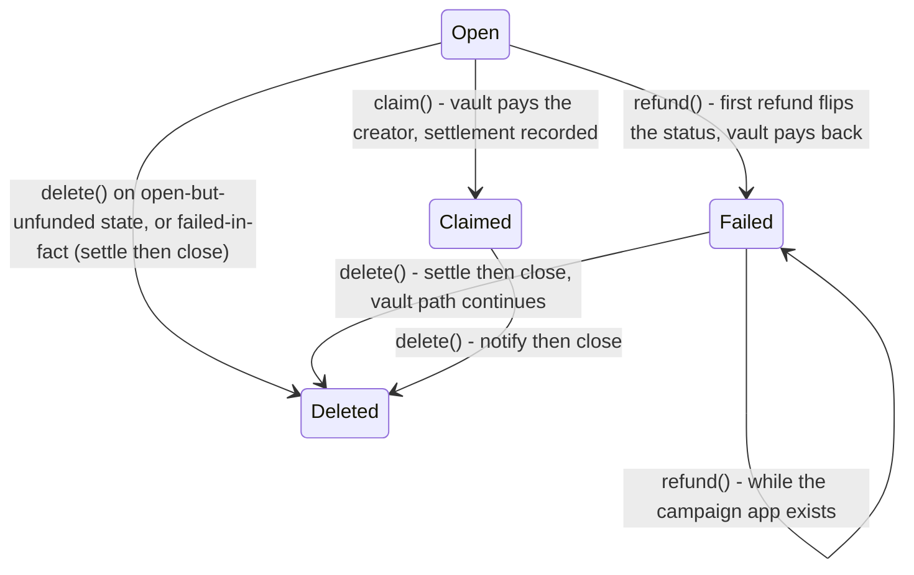

# Campaign contract

This page is the reference for the Campaign app: its state, its methods, and the rules each method enforces. The tree math behind pledges and refunds is in [`claim-tree-protocol.md`](claim-tree-protocol.md); the system around the contract is in [`architecture.md`](architecture.md). Compiled sizes, page counts, MBR, and fee formulas are in [`limits.md`](limits.md).

The chain is the source of truth; the indexer is a read model. Escrow and fee behavior below is verified on LocalNet.

## Trust model and receipts

The campaign escrow is never funded and holds nothing. Every pledge payment goes to the vault app account. Each pledge appends one receipt leaf to the campaign's incremental Merkle tree, computed as:

```text
leaf = H(0x01 ‖ backer-address ‖ amount ‖ payment-txid)
```

The leaf commits to the full receipt. Consequences for backers:

- Your pledge is the sum of your live leaves. Re-pledging appends another leaf; the contract adds it to `raised`.
- A cancel or refund nulls the leaf in place. Your leaf stays visible in history with amount zero, so replays can never resurrect it.
- A refund or cancel needs the leaf data (position, amount, payment TxID) plus the authentication path. The frontend rebuilds both from the indexer; the contract verifies the path against the stored root.
- No per-backer state exists on-chain. Nothing to opt into, nothing to close.

The contract owns the root; the frontend owns reconstruction. A stale or forged frontier or path fails closed with state untouched.

## Global state and boxes

### Campaign global state (4 byte-slices + 6 uints)

| Key | Type | Set | Meaning |
| --- | --- | --- | --- |
| `creator` | Account | `create` | Receives `claim()`; authorizes `delete()` |
| `vault` | Application | `create` | ClaimsVault app; receives pledge payments |
| `title` | bytes | `create` | Short on-chain title, max 128 bytes |
| `metadataUri` | bytes | `create` | Off-chain metadata pointer (ARC-3-style JSON), max 128 bytes |
| `goal` | uint64 | `create` | Raise target in microAlgos, must be > 0 |
| `deadline` | uint64 | `create` | UNIX seconds; must be in the future at creation |
| `raised` | uint64 | pledges/spends | Live pledged total; rises on `pledge`, falls on `cancelPledge`/`refund` |
| `status` | uint64 | settlement | `0 = Open`, `1 = Failed`, `2 = Claimed` |
| `root` | bytes32 | pledges/spends | Current Merkle root |
| `n` | uint64 | pledges | Append counter; positions are never reused |

### Vault box (per campaign, 65 bytes)

Key = `'c' + appId` (9 bytes). Value = `paidIn (8) ‖ paidOut (8) ‖ root (32) ‖ N (8) ‖ status (1) ‖ settledAt (8)`. Box MBR = 2,500 + 400 × (9 + 65) = **32,100 µA**, parked on the vault's platform-funded account and released by `notifyDelete` / `releaseClaimed` / `finalize`. Opening the box is the vault's only per-campaign cost.

## State machine

`status` starts `Open` and moves one way:



Transitions:

- `claim()` writes `Claimed`, sends the vault total `paidIn - paidOut` to the creator. Only the creator, only after the deadline, only when `raised >= goal`. Double claims fail (`status != Open`).
- The first `refund()` flips the campaign status to `Failed`. The vault box stays `Open` until settlement: `root`/`N`/`settledAt` are recorded when `delete()` settles or when `settleOpen` runs. Any later refund, or vault-direct refund, nulls one leaf and pays the backer. `cancelPledge` works only while `Open`.
- `delete()` settles through the vault, pays the app's leftover balance to the creator, and closes the escrow. Only the creator. `delete()` on a live campaign with live pledges fails, except failed-in-fact (deadline passed, goal missed), which settles then closes; on a `Claimed` campaign it notifies the vault so the box deletes. When the campaign's vault has a Factory binding, `delete()` requires the Factory's `unregister` (a NoOp app call) to be the immediately preceding transaction; the Factory requires the delete immediately after, so delisting and deletion are one atomic operation and a raw delete of an official campaign is rejected. An unregistered campaign's `unregister` is a no-op, so the same group cleans up a registration that never landed.
- Settling never depends on reading a possibly-deleted app: the campaign pushes `root`/`N`/`settledAt` into the vault box at settle time.

## Methods

| Method | Who | When | Does |
| --- | --- | --- | --- |
| `create(vault, title, metadataUri, goal, deadline)` | anyone | once | Stores creator/vault/title/uri/goal/deadline; zeroes `raised`/`status`/`root`/`n` |
| `pledge(payment, frontier)` | any backer except creator | `Open`, before deadline | Appends one leaf; `raised += amount`; vault records the inflow |
| `cancelPledge(k, amount, txid, path)` | leaf owner (path-bound) | `Open`, before deadline | Nulls leaf `k`; `raised -= amount`; vault pays the backer |
| `refund(k, amount, txid, path)` | leaf owner (path-bound) | after deadline, goal missed, `Failed` | Nulls leaf `k`; `raised -= amount`; vault pays the backer |
| `claim()` | creator | after deadline, goal met | Vault pays the creator `paidIn - paidOut`; writes `Claimed` |
| `delete()` | creator | settled, or open with no live pledges | Settles through the vault, pays leftover balance to the creator, closes the app |

`create` rejects an empty title, a title or URI over 128 bytes, a zero goal, and a past deadline. `pledge` rejects pledges after the deadline, when not `Open`, with a wrong payment receiver or sender, with a zero amount, from the creator, and with a frontier whose length or fold does not match. `refund` and `cancelPledge` reject unknown positions, bad TxIDs, wrong path lengths, and proofs that do not match the root. Amounts are never reduced by fees.

## Pledge accounting

`raised` counts live leaves only. Each spend subtracts the spent amount, so the creator's claim is the live total by construction:

```text
pledge 300 → raised 300
pledge 200 → raised 500
cancel 300 → raised 200
claim        → creator paid 200
```

Pledge does not mint assets, write per-backer boxes, or touch global state beyond `raised`/`root`/`n`. The vault's `paidIn` counts verified inflows independently, and every vault outflow runs a balance guard (`amount <= paidIn - paidOut`), so no accounting bug in the campaign can drain another campaign's funds.

## Design decisions

1. **Hash opcode.** `op.sha256` is plain SHA-256; the protocol hash is `op.sha512_256` (same cost). The offline and integration suites pin this differentially against the Python oracle.
2. **One App-call per spend.** Each `cancelPledge`/`refund` spends one leaf. Grouping N spends per call is possible but adds paths, larger boxes, and messier failure modes for no fee saving (each spend is one app call either way).
3. **No ASA anywhere.** Assets would add opt-in minimum balances, clawback trust, and per-holder state. The tree needs none of that.
4. **Vault-local settlement markers.** `app_global_get_ex` fails on deleted apps, so vault logic never reads a possibly-deleted campaign's state. The campaign pushes `root`/`N`/`settledAt` into its vault box; `settleOpen` covers vanished-creator campaigns from live globals.
5. **Delete-before-fund is a creator no-op.** `delete()` materializes failed-in-fact campaigns (deadline passed, goal missed) through `settle` before closing, so a failed campaign with no live pledges deletes without stranding anything.
6. **Unconditional settle on delete.** `delete()` settles for every non-`Claimed` campaign, even pristine ones, so any existing box is settled and swept through `finalize` instead of stranding. New credits always follow a pledge, so there are no new pledge-less inflows.
7. **Creator pays the way.** Nothing funds the campaign app itself. The current campaign program is 2 pages (2,053 B total, 1 extra page), so creation locks the app MBR (321,000 µA) plus the 18,900 µA registration deposit = **339,900 µA (~0.34 ALGO)**, all of it returned O(1) in the atomic `[unregister, delete]` group; the create flow also spends ~5,000 µA in transaction fees. The 1-page target was ~0.24 ALGO (239,900 µA); an extra page adds 100,000 µA. The 32,100 µA box MBR sits on the vault's platform-funded account and returns to the vault pool via `notifyDelete` / `releaseClaimed` / `finalize`. See [`limits.md`](limits.md) for the current size/MBR/fee table and the rule against silently changing this cost.
8. **No metadata updates.** `title` and `metadataUri` are creation-time fields and there is no `updateMetadata()`, deliberately: a backer's pledge can never be re-described under them. Corrections and progress ship through the off-chain creator updates feed ([`roadmap.md`](roadmap.md)), and mutability can return later via the off-chain JSON.

## Multi-backer examples

Pledges accumulate per leaf; spends null per leaf:

```text
A pledges 300 (leaf 0), B pledges 200 (leaf 1) → raised 500, root R2
A cancels leaf 0                              → raised 200
deadline passes, goal missed
B refunds leaf 1                              → raised 0
```

Double-spend of one leaf fails: the second proof no longer matches the root. Concurrent spends that move the root between read and submit fail the same way; the frontend rebuilds the proof once and retries.

## Vault interaction

The campaign never holds funds, so every money movement is an inner vault call:

- `pledge` pairs with top-level `Vault.credit(app, amount)`, which verifies the payment from the outer group and adds it to `paidIn`.
  The payment must be immediately before `pledge`, and the matching `credit` must be immediately after it and the group's final
  transaction; both the pledge and credit must be `NoOp` app calls (`ClearState` runs the clear program and is rejected). The vault
  also requires that preceding `pledge`, so a credit without a pledge is rejected and every payer is a
  backer. `pledge` asserts the credit's app id and amount, so a pledge can never be left uncredited. First-touch `credit` also
  checks Factory registration, so an unregistered campaign cannot open a vault box.
- `cancelPledge`/`refund` inner-call `payBack`; `claim` inner-calls `payClaim` with the derived amount `paidIn - paidOut`.
- `delete` inner-calls `settle` (or `notifyDelete` when `Claimed`). A claimed box can also be released permissionlessly with
  `Vault.releaseClaimed(app)`; `notifyDelete` is then a no-op, so the campaign still deletes cleanly.

Inner calls authenticate the caller as the campaign app address; top-level calls to `payBack`/`payClaim`/`settle`/`notifyDelete` fail. Box access on the outer transaction must declare the vault campaign box. The full vault reference is in the protocol spec (§9); the fee table below carries the measured outer-call costs.

## Testing

The full behavioral matrix lives in `contract.algo.spec.ts` (42 tests, 100% lines/branches/functions) plus the LocalNet integration suite (9 tests, µA-exact ledger accounting, oracle-differential roots). Vault and Factory suites live next to their contracts. See [`testing.md`](testing.md).

## Fees

Measured on LocalNet; each inner transaction costs one extra minimum fee (1,000 µA) via `extraFee`. Amounts are never reduced by fees. The full size/MBR/fee table, including the current create cost and the fixed SDK extras, is in [`limits.md`](limits.md).

| Call | SDK total | Minimum (small tree) | Notes |
| --- | ---: | ---: | --- |
| create + register | 5,000 µA | 5,000 µA | plus 339,900 µA locked (app MBR + deposit) |
| pledge group (pay + pledge + credit) | 4,000 µA | 4,000 µA first touch, 3,000 µA later | first touch runs the inner Factory check |
| `cancelPledge` / campaign `refund` | 4,000 µA | 2,000 µA | app call + inner `payBack` + OpUp |
| vault `refund` | 4,000 µA | 1,000 µA | app call + OpUp |
| `claim` | 3,000 µA | 3,000 µA | app call + inner `payClaim` + inner payment |
| `[unregister, delete]` | 5,000 µA | 5,000 µA | unregister + deposit + delete + settle/notify + escrow close |
| `delete` alone (campaign) | 3,000 µA | 3,000 µA | settle/notify + escrow close |
| `Factory.unregister` alone | 2,000 µA | 2,000 µA | unregister + inner deposit |
| `settleOpen` (no inners) | 1,000 µA | 1,000 µA | permissionless; not exposed in the SDK/CLI yet |
| `finalize` | 2,000 µA with residual, 1,000 µA without | same | permissionless; not exposed yet |
| `releaseClaimed` | 1,000 µA | 1,000 µA | permissionless; not exposed yet |

## Implementation notes

1. **OpUp sizing.** Each `ensureBudget` iteration submits two inners (create + delete), so budget calls cost double the iteration count: pledge/cancel/refund size for it, `claim` for the inner call plus payment, `delete` for settle/notify plus close.
2. **Two encoding rules for raw inner appArgs** (see the vault interaction above). ABI-encode dynamic types: the settle `root` (`byte[]`) carries its uint16 length prefix. Static `uint64`/`address` args go raw.
3. **Delete path.** `delete()` uses the dedicated `send.delete` path (or a manual composer group with `DeleteApplicationOC`). `send.call` with an `onComplete` override mis-encodes the call.
4. **No `updatable`/`deletable` flags.** Do not pass them to `factory.send.create`; the contract TEAL has no deploy-time templates for them.
5. **Factory program hash.** Registration currently compares `sha256(approval ‖ clear)` over the approval **and clear-state** programs. The concatenation has no length prefix, so it is ambiguous: different approval/clear splits of the same bytes hash the same. A length-prefixed (or separate) hash is tracked in [`roadmap.md`](roadmap.md); until it lands, do not treat the hash as a unique program-pair check. After any contract rebuild, set the new hash on the Factory before registering; any campaign program change changes the hash. See [`limits.md`](limits.md).
