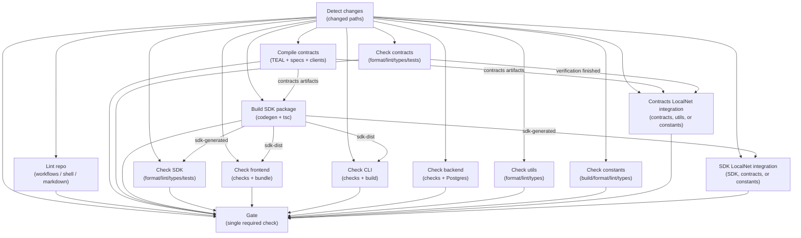

# CI

This page describes the GitHub Actions setup: a consolidated
[`build-and-test`](../.github/workflows/build-and-test.yml) workflow with one
verification job per project plus repo-wide workflow, shell, and Markdown lint,
the separate scheduled/manual
[`heavy-tests`](../.github/workflows/heavy-tests.yml) workflow, and the manual
[`release-contracts`](../.github/workflows/release-contracts.yml),
[`release-constants`](../.github/workflows/release-constants.yml),
[`release-sdk`](../.github/workflows/release-sdk.yml), and
[`release-cli`](../.github/workflows/release-cli.yml) releases - plus the
reasoning behind the splits.

## Principles

- **Build once, share the output.** The compiled contract artifacts (TEAL +
  ARC specs) are gitignored and regenerable. A contracts, `utils`, or
  `constants` change triggers `compile-contracts`, which compiles them once and
  uploads `contracts-artifacts`; `build-sdk` and `integration-test-contracts`
  download it
  instead of recompiling. When
  the SDK or contracts changed, `build-sdk` runs codegen once, compiles the
  package once, and uploads both `sdk-generated` (the generated clients) and
  `sdk-dist` (the compiled package). The SDK verification job downloads
  `sdk-generated` instead of regenerating clients; the frontend and CLI
  download `sdk-dist` instead of each rebuilding the SDK; the SDK LocalNet
  integration job also downloads `sdk-generated` so it tests the same clients.
  A `workspace`-only run skips the producer, so SDK verification regenerates
  the clients from the pinned release itself. The SDK never copies generated
  clients between projects: it regenerates them from the ARC-56 specs, from the
  downloaded artifacts (`SDK_SPECS=local`) in runs where `compile-contracts`
  produced artifacts and from
  the pinned release otherwise.
- **The compiled footprint is gated.** `compile-contracts` runs
  `npm run test:size` after `npm run build`, so a byte, page, or schema change
  fails unless `test/utils/size-budget.fixture.ts` and `docs/limits.md` are
  updated. `check-contracts` does not build artifacts, so the size test is
  excluded from `npm test` and `test:coverage`.
- **The constants build is committed.** `projects/constants/dist` is tracked so
  `file:` consumers install it without a per-job build. `check-constants`
  rebuilds it and fails when the committed output drifts from `src`.
- **Split by prerequisite, not by phase.** Each project has one verification
  job that runs format, lint, type-check, and tests in order; a failed check
  does not stop the remaining checks, so one run reports them all. Contract
  compilation and SDK packaging are separate producer jobs only because other
  jobs consume their artifacts; `integration-test-contracts` and
  `integration-test-sdk` add Docker for LocalNet. Keeping those in separate
  jobs (not separate workflows) keeps feedback fast and failures attributable
  to the right lane.
- **Change detection, not matrices.** One `changes` job runs
  [`dorny/paths-filter`](https://github.com/dorny/paths-filter) and decides
  what every other job runs against. Each filter is a lane input: contracts,
  SDK, frontend, CLI, backend, `utils`, `constants`, `ci` (workflows/scripts),
  `oracle` (the contract/SDK test oracle), `markdown`, `shell`, and `workspace`.
  Unknown root paths land in `workspace`, which fails open to the verification
  lanes but never sets `contracts`: `compile-contracts` and
  `integration-test-contracts` run only when the contracts, `utils`, or
  `constants` changed, and
  `check-contracts` runs for contracts, `utils`, `constants`, the oracle, or
  workspace changes. Markdown, shell, and
  workflow files run only `repo-lint`; docs images, licenses, and inert root
  files run no lane.
  `.prettierrc.json` is part of `workspace`, so formatting-config changes are
  not a special filter.
- **The trigger policy is centralized.** `changes` publishes derived `run_*`
  outputs (`run_repo_lint`, `run_compile_contracts`, `run_check_contracts`,
  `run_build_sdk`, `run_check_sdk`, `run_check_frontend`, `run_check_cli`,
  `run_check_backend`, `run_check_utils`, `run_check_constants`,
  `run_contracts_integration`, `run_sdk_integration`). Every job reads one boolean, so the
  trigger rules live in one place instead of repeated `if` expressions.
  Separate jobs (no matrix) keep the conditional presence and the status-check
  names stable.
- **The frontend and CLI resolve the SDK by what changed.** A frontend-only,
  CLI-only, or workspace-only change installs the published `@kasakame/sdk`, so
  routine work exercises what users install; an SDK or contracts change
  downloads the same-run `sdk-dist` built by `build-sdk` and installs that copy
  instead (see below). SDK verification consumes the same-run `sdk-generated`.
  The frontend and CLI build against the same SDK choice. The backend runs as
  its own job (it needs a Postgres service, so it doesn't fit the pure-Node
  jobs) and is independent of contracts, SDK, frontend, and CLI.
- **CI calls the per-project npm scripts directly** (`npm run lint`, …), not
  `algokit project run`. The algokit wrapper is a local convenience and runs
  projects sequentially.
- **Repo checks cover workflows, shell scripts, and Markdown.** The
  `repo-lint` job runs actionlint for `.github/**`, the runner's preinstalled
  ShellCheck over every tracked `.sh`/`.bash` file via `git ls-files`
  (`shellcheck -x` follows sourced files), and markdownlint. Each step is
  conditional on its filter and independent, so one failure does not hide the
  others. Workflow files are checked by actionlint; the multi-line AlgoKit and
  local-SDK install blocks live in `.github/scripts/*.sh` and are checked by
  ShellCheck.
- **Run once per change.** The workflow triggers on `pull_request` (any branch)
  and on `push` to `main` only - a same-repo branch would otherwise fire both
  `push` and `pull_request` events and run everything twice. Superseded PR runs
  are cancelled; `main` runs finish. Manual `workflow_dispatch` skips change
  detection and forces the full graph for debugging. Every `build-and-test` job
  has a `timeout-minutes` bound.

## Job graph



## What each job needs

| Job | Runs when | Node.js | AlgoKit CLI | Docker | Artifacts it consumes |
| --- | --- | --- | --- | --- | --- |
| `changes` | always | - | - | - | - |
| `repo-lint` | `ci`, `shell`, or `markdown` changed | ✅ | - | ✅ (actionlint image) | - |
| `compile-contracts` | contracts, `utils`, or `constants` changed | ✅ | ✅ | - | - (produces `contracts-artifacts`) |
| `check-contracts` | contracts, `utils`, `constants`, `oracle`, or `workspace` changed | ✅ | - | - | - |
| `build-sdk` | SDK, contracts, or `constants` changed | ✅ | - | - | `contracts-artifacts` when `compile-contracts` ran; produces `sdk-generated` + `sdk-dist` |
| `check-sdk` | contracts, SDK, `utils`, `constants`, `oracle`, or `workspace` changed | ✅ | - | - | `sdk-generated` when the producer ran; regenerates from the pinned release otherwise |
| `check-frontend` | contracts, SDK, `constants`, frontend, or `workspace` changed | ✅ | - | - | `sdk-dist` when SDK/contracts changed; published package otherwise |
| `check-cli` | contracts, SDK, `constants`, CLI, or `workspace` changed | ✅ | - | - | `sdk-dist` when SDK/contracts changed; published package otherwise |
| `check-backend` | backend or `workspace` changed | ✅ | - | ✅ (Postgres service) | - |
| `check-utils` | `utils` or `constants` changed | ✅ | - | - | - |
| `check-constants` | `constants` changed | ✅ | - | - | - |
| `integration-test-contracts` | contracts, `utils`, or `constants` changed | ✅ | ✅ | ✅ (algod + indexer) | `contracts-artifacts` |
| `integration-test-sdk` | SDK, contracts, or `constants` changed | ✅ | ✅ | ✅ (algod + indexer) | `sdk-generated` |
| `heavy-tests` (own workflow) | weekly schedule or manual | ✅ | ✅ | ✅ (algod only) | - (builds its own artifacts) |
| `gate` | always | ✅ (runner only) | - | - | - |
| `release-contracts` (own workflow) | manual | ✅ | ✅ | - | - |
| `release-constants` (own workflow) | manual | ✅ | - | - | - |
| `release-sdk` (own workflow) | manual | ✅ | - | - | - |
| `release-cli` (own workflow) | manual | ✅ | - | - | - |

Key point: **format/lint/type-check, unit-test, markdown, and shell lint need no
AlgoKit install**. `eslint`, `prettier`, `tsc`, `vitest`, `markdownlint-cli2`, and
`shellcheck` are standalone tools; `actionlint` is the one repo-lint step that
uses a container. The contracts verification job does not build anything: the
offline contract suite runs the contract source directly, and only
`compile-contracts` compiles. `build-sdk` runs codegen against the same-run
artifacts or the pinned release; SDK verification consumes the resulting clients,
and the frontend and CLI install the published SDK or the packed `sdk-dist` copy -
see below. The backend lane is the exception: its suite runs against a throwaway
Postgres service (static checks first, then migrations and tests).

Verification jobs run format → lint → type-check → tests → build (where a build
belongs to the job). A failed check does not stop the remaining checks: the job
still fails, but the log reports all of them together. Producer jobs
(`compile-contracts`, `build-sdk`) fail fast because there is no artifact to share
after a failure.

## Why the SDK build needs same-run contract artifacts

The SDK's write path imports the generated clients (`src/generated/*`,
gitignored), which `scripts/codegen.ts` regenerates from ARC-56 specs with the
pinned `@algorandfoundation/algokit-client-generator`. By default codegen
reads the installed `@kasakame/contracts` package
(`node_modules/@kasakame/contracts/dist/arc56`); `SDK_SPECS=local` reads
`projects/contracts/smart_contracts/artifacts` instead. When
`compile-contracts` ran `build-sdk` downloads `contracts-artifacts` and runs
codegen with `SDK_SPECS=local`, so the generated clients, the type-check, the
tests, and the built SDK all resolve against the change set's contracts;
otherwise it installs `@kasakame/contracts` at the version in
`projects/contracts/package.json` and uses the released package. `build-sdk`
uploads the generated clients as `sdk-generated`, which SDK verification
downloads instead of regenerating them. Codegen never builds the contracts:
local mode fails with instructions if the artifacts are absent.

## How the frontend and CLI jobs resolve the SDK

The committed frontend and CLI dependency is `"@kasakame/sdk": "^0.1.0"` (see
[`sdk.md`](sdk.md)). On a frontend-only, CLI-only, or workspace-only change those
lanes install it from the registry with `npm ci`, so routine work exercises
exactly what users install.

When the SDK or the contracts changed, `build-sdk` runs codegen and builds the
SDK package once (`npm ci` + `npm run build` in `projects/sdk`; codegen uses the
same-run artifacts when the contracts changed, the pinned release otherwise),
uploads `sdk-generated` and `sdk-dist`, and the frontend and CLI lanes download
`sdk-dist` and install it as a packed copy:

```sh
npm install --no-save --install-links "file:../sdk"
```

`--install-links` packs the SDK directory and installs it like a tarball (same
shape as the published package) instead of symlinking it; `--no-save` leaves
`package.json`/`package-lock.json` untouched. A plain `npm ci` afterwards
restores the published package. Local contract/SDK work uses the same command
(build the SDK first), so there is nothing to revert.

The `check-frontend` job bundles against the same SDK choice: published for
frontend-only, CLI-only, or workspace-only changes, the same-run `sdk-dist` for
SDK/contracts changes. `check-cli` type-checks and builds against that same
choice. `check-sdk` downloads `sdk-generated` from the producer; when the
producer is skipped (`workspace`-only changes), it regenerates from the pinned
release.

## Workflow: build-and-test

Implemented at `.github/workflows/build-and-test.yml`. Eleven jobs. `changes`
runs `dorny/paths-filter@v4.0.3`: PRs use the changed-files API (hence
`pull-requests: read`), and pushes to `main` diff against the previous commit
on the branch (`github.ref` as the base on pushes). Manual dispatch skips
change detection and forces every `run_*` output, so it executes the full
graph. The workflow defaults to
`permissions: contents: read`; `changes` adds `pull-requests: read` for the PR
changed-files API. No job needs repository write access. Licenses are excluded
from every filter; Markdown files and `.markdownlint-cli2.jsonc` only set
`markdown`. It exposes the raw filters plus derived trigger outputs:

- `contracts`, `sdk`, `frontend`, `cli`, `backend`, `utils`, `constants` - the
  project path itself, no folding. A contracts change does not set `sdk`,
  `frontend`, `cli`, `utils`, or `constants`; the derived outputs OR the inputs
  they need. `check-utils` runs the private helper package's format, lint, and
  type-check; `check-constants` rebuilds the public constants package and fails
  when the committed `dist` drifts. Changes to `utils` or `constants` re-run the
  contract and SDK checks that consume them.
- `ci` - `.github/**` (workflows and release scripts).
- `oracle` - `docs/claim-tree-protocol-reference.py`, the contract/SDK test
  oracle. `check-sdk` also regenerates the committed claim-tree vectors from it
  and fails on drift. An oracle-only change does not trigger LocalNet, so it
  runs the offline suites, not `integration-test-contracts`.
- `markdown` - `**/*.md` and `.markdownlint-cli2.jsonc`.
- `shell` - tracked shell scripts: `**/*.sh` and `**/*.bash`.
- `workspace` - any other non-inert root path outside the seven projects (root
  config, `.prettierrc.json`, a new project). It fails open to the verification
  lanes but never sets `contracts`: `compile-contracts` and
  `integration-test-contracts` run only when the contracts, `utils`, or `constants` changed. Markdown,
  shell scripts, docs images, licenses, and inert root files are excluded from
  it.
- `run_repo_lint` - `ci || shell || markdown`.
- `run_compile_contracts` - `contracts || utils || constants`.
- `run_check_contracts` - `contracts || utils || constants || oracle || workspace`.
- `run_build_sdk` - `contracts || sdk || constants`; the frontend and CLI lanes
  also use it to choose the packed local SDK instead of the published package.
- `run_check_sdk` - `contracts || sdk || utils || constants || oracle || workspace`.
- `run_check_frontend` - `contracts || sdk || constants || frontend || workspace`.
- `run_check_cli` - `contracts || sdk || constants || cli || workspace`.
- `run_check_backend` - `backend || workspace`.
- `run_check_utils` - `utils || constants`.
- `run_check_constants` - `constants`.
- `run_contracts_integration` - `contracts || utils || constants`.

Every `run_*` output is true on a manual `workflow_dispatch`.

- **`changes`** - checkout with `fetch-depth: 0`, the paths-filter action, and
  the outputs; no Node setup, seconds of work.
- **`repo-lint`** - runs when `run_repo_lint` is true. Runs
  actionlint in the `rhysd/actionlint:1.7.12` container (which bundles
  ShellCheck for workflow `run:` blocks), the runner's preinstalled ShellCheck
  over every tracked `.sh`/`.bash` file via `git ls-files`, and
  `npx --yes markdownlint-cli2@0.23.2` over every `*.md` file. The steps are
  independent, so one failure does not hide the others.
- **`compile-contracts`** - runs when `run_compile_contracts` is true. Installs Node + AlgoKit,
  compiles the contracts (`npm run build` → TEAL + ARC-56 specs and generated
  clients), and uploads `contracts-artifacts` with `overwrite: true` and 7-day
  retention.
- **`check-contracts`** - runs when `run_check_contracts` is true (contracts,
  utils, oracle, or workspace). Pure Node: format, lint, type-check, and
  `npm run test:coverage`. The offline suite runs the contract source directly,
  so it never needs the compiled artifacts. A failed check does not stop the
  rest.
- **`build-sdk`** - runs when `run_build_sdk` is true (SDK or contracts
  changed). Downloads `contracts-artifacts` when the contracts changed, installs
  the SDK dependencies, builds the package (`npm run build` → codegen + tsc),
  and uploads `sdk-generated` and `sdk-dist` (7-day retention).
- **`check-sdk`** - runs when `run_check_sdk` is true (contracts, SDK, utils,
  oracle, or workspace). Downloads `sdk-generated` when `build-sdk` ran; when
  the producer was skipped (`workspace`-only changes), regenerates the clients
  from the pinned release. Then format, lint, type-check, and `npm run test:coverage`.
  It does not download `contracts-artifacts` directly. It also regenerates
  `src/claim-tree.vectors.ts` from the Python oracle, formats it, and fails with
  `git diff --exit-code` when the committed vectors are stale.
- **`check-frontend`** - runs when `run_check_frontend` is true (contracts, SDK,
  frontend, or workspace). Installs the published SDK with `npm ci`, or the
  same-run `sdk-dist` as a packed copy when `run_build_sdk` is true, then format,
  lint, type-check, `npm run test:coverage`, and `npx vite build`. The bundle
  gate is in this job, after the tests.
- **`check-cli`** - runs when `run_check_cli` is true (contracts, SDK, CLI, or
  workspace). Installs the published SDK with `npm ci`, or the same-run
  `sdk-dist` as a packed copy when `run_build_sdk` is true, then format, lint,
  type-check, `npm run test:coverage`, and `npm run build`. The suite mocks the
  WalletConnect transport, so CI never contacts the bridge. See
  [`cli.md`](cli.md) and the [CLI tests](testing.md#cli-tests).
- **`check-backend`** - runs when `run_check_backend` is true (backend or
  workspace): starts a Postgres service, runs format, lint, and type-check, then
  migrations and `npm run test:coverage`. It is independent of
  contracts/SDK/frontend/CLI.
- **`check-utils`** - runs when `run_check_utils` is true (`utils` changed):
  installs the private package, then format, lint, and type-check. It produces
  no artifact and publishes nothing.
- **`integration-test-contracts`** - runs when
  `run_contracts_integration` is true and waits for
  `compile-contracts` (the artifact) and `check-contracts` (verification). It
  runs even if contract verification failed, so a lint/test failure still
  reports the LocalNet result: downloads `contracts-artifacts`, starts LocalNet,
  and runs the compiled TEAL against a live algod (files `00`-`07`: the normal,
  scale, boundary, and randomized-sequence suites).
- **`integration-test-sdk`** - runs when `run_sdk_integration` is true and
  `build-sdk` succeeded. It installs the SDK dependencies, downloads
  `sdk-generated`, starts LocalNet, and runs the SDK send-path suite (files
  `00`-`04`). It is independent of the contract LocalNet lane.
- **`gate`** - depends on all of the above and passes when every job is
  `success` or `skipped`; it fails on `failure`/`cancelled`. Branch protection
  requires only this check, so skipped jobs don't block a merge.

Verification jobs order the checks format → lint → type-check → tests → build,
and a failed check does not stop the later ones. The step conditions use
`!cancelled()` instead of the implicit `success()` gate, so a failed
format/lint/type-check still runs the tests and the bundle. The job still fails,
but one run reports all failures. `compile-contracts` and `build-sdk` fail fast
because there is no artifact to share after a failure.

`npm run format` runs Prettier in `--check` mode, so style drift fails the build
without modifying files.

## Workflow: heavy-tests (separate file)

Implemented at `.github/workflows/heavy-tests.yml`. This workflow is the only
LocalNet lane **outside** the PR graph: it never runs on `pull_request` or
`push`, is not part of the `Gate`, and cannot block a merge. It runs the
cap-scale suites (`test/99-*`). It runs:

- on a weekly `schedule` (Monday 03:00 UTC), from the default branch; the
  schedule runs both cap outcomes;
- on `workflow_dispatch`, with an optional `ref` input (branch, tag, or SHA) and
  a `suite` choice (`all`, `failed`, `claimed`; default `all`).

The `failed` and `claimed` jobs run in **parallel** on separate runners, each
with its own LocalNet:

- `failed` - `npm run test:cap:failed`: fills a 524,287-position tree, then
  exercises the worst-case refund, the post-delete vault refunds, and the
  residual sweep;
- `claimed` - `npm run test:cap:claimed`: fills the same tree, then claims and
  deletes.

Each job builds the contracts, starts LocalNet, and stops the indexer pipeline
(`indexer`, `conduit`, `postgres`) before the run: the suites read algod only,
and the indexer's database would otherwise consume the runner disk over the
multi-hour run. The measured pledge path is about 35 positions/s, so each job
needs roughly 5 hours; the timeout is the 360-minute GitHub-hosted maximum. The
suites stream an initial line, a heartbeat with the pledge rate and ETA every
5,000 positions (~2.5 minutes at the measured rate), and phase lines for the
deadline, refunds, delete, and claim/finalize. A job that cannot finish
inside the limit fails without affecting the other outcome. The SDK and CLI
LocalNet suites stay with #158 and #118.

The `05`-`07` scale, boundary, and randomized-sequence suites are **not** in this
workflow: they run in the `integration-test-contracts` job in the PR `build-and-test`
workflow, together with files `00`-`04`.

## Workflow: release-contracts (separate file)

Implemented at `.github/workflows/release-contracts.yml`. Manual
(`workflow_dispatch`) release of the **contract artifacts**: it builds the
contracts from the dispatched commit, runs the offline contract tests and the
package check, attaches the compiled per-app artifacts to a GitHub Release
tagged `contracts-v<version>` as one tarball per artifact kind -
`arc56.tar.gz` (ARC-56 specs), `arc32.tar.gz` (ARC-32 specs), `teal.tar.gz`
(approval/clear TEAL), and `puya.tar.gz` (`*.puya.map` source maps) - each
keeping the per-app directories, and publishes the matching
`@kasakame/contracts` npm package from the same build. Generated clients are
never attached or published. Its own file because it is a release, not a CI
gate: it runs manually (contracts rarely change) and needs `contents: write`
to create the release. The version is a dispatch input and must match
`projects/contracts/package.json`; bump that version in the release commit.
`prerelease` defaults on while the interface can still break on TestNet; GitHub
pre-release status only affects the "Latest" label, not downloads by tag.

The npm tarball is the tested artifact passed from the prep job to the smoke and
publish jobs, so `npm publish` publishes exactly the checked bytes. The smoke
job installs the tarball in a clean consumer and reads an ARC-56 spec. The
publish job uses npm OIDC trusted publishing with `--provenance`. `dry_run`
defaults to true and skips both the GitHub release and the npm publish.

The SDK installs `@kasakame/contracts` at the version in
`projects/contracts/package.json` and regenerates its clients from
`dist/arc56` with its own pinned generator; `SDK_SPECS=local` uses the
contracts project's artifacts for contracts, `utils`, or `constants` changes
and local contract work. Nothing generated is committed. The other tarballs
serve deployers and verifiers: the ARC-32 specs for legacy tooling, and the
TEAL plus source maps for independent recompile-and-verify audits.

Configure the trusted publisher for `@kasakame/contracts` on npmjs.com
(package Settings → Trusted Publisher) with GitHub owner `kasakame`, repository
`kasakame`, workflow `release-contracts.yml`, and no environment. Enable
**Allow npm publish**. Configure the trusted publisher before the next
contracts release; that OIDC release validates it, and an unused configuration
expires after 2 days.

## Workflow: release-constants (separate file)

Implemented at `.github/workflows/release-constants.yml`. Manual
(`workflow_dispatch`) release of `@kasakame/constants`; no reviewer gate (single
developer). The version is `projects/constants/package.json`; bump it in the
release commit. The dispatch inputs mirror the SDK release:

- `version`: required, without the `v` prefix; must match the package version.
- `dry_run`: defaults to `true`; runs the gate, smoke test, package inspection,
  and the prep publish dry-run, but skips the real publish and registry check.

Prerelease versions publish under the `next` dist-tag, finals under `latest`.

- `prep` installs the package, validates the input version against
  `package.json` and that it is unpublished, builds `dist`, verifies the
  committed `dist` is unchanged, formats, lints, type-checks, inspects the
  packed tarball, dry-runs the publish, and installs the tarball in a clean
  consumer to import the compiled values. It uploads the tested `dist/`.
- `publish` downloads the tested `dist/`, verifies the package files and
  version, and, when `dry_run=false`, publishes with the `next`/`latest`
  dist-tag through npm OIDC trusted publishing (`id-token: write`) with
  `--provenance`, then polls the registry for the version for up to 10 minutes.

Configure the trusted publisher for `@kasakame/constants` on npmjs.com
(package Settings → Trusted Publisher) with GitHub owner `kasakame`, repository
`kasakame`, workflow `release-constants.yml`, no environment, and **Allow npm
publish** enabled. Release it before the SDK and CLI: both declare it as a peer
dependency, and their smoke tests install it from the registry. Configure the
trusted publisher before the next constants release; an unused configuration
expires after 2 days.

## Workflow: release-sdk (separate file)

Implemented at `.github/workflows/release-sdk.yml`. Manual (`workflow_dispatch`)
release of `@kasakame/sdk`; no reviewer gate (single developer). The version is
`projects/sdk/package.json`; bump it in the release commit. The dispatch inputs
are:

- `version`: required, without the `v` prefix; must match the package version.
- `dry_run`: defaults to `true`; runs the gate, integration suite, smoke test,
  package inspection, and the prep publish dry-run, but skips the real publish
  and registry check.

Prerelease versions publish under the `next` dist-tag, finals under `latest`.

- `prep` is Node/npm only and never builds the contracts: it validates the
  input version against `package.json` and that it is unpublished, installs the
  released `@kasakame/contracts` at the version in
  `projects/contracts/package.json`, regenerates clients, compiles TypeScript,
  lints, format-checks, type-checks, runs coverage, inspects the packed
  tarball, and dry-runs the publish. Each command is its own step. It uploads
  the tested `dist/` and the generated clients.
- `integration` starts LocalNet, downloads the prep-generated clients and the
  tested `dist/`, checks the dist imports, and runs `npm run test:integration`.
  It gates the publish.
- `smoke` runs `projects/utils/smoke/sdk.ts`: it packs the tested `dist/`,
  installs the tarball into a clean consumer (npm pulls the
  `@kasakame/constants` and `@algorandfoundation/algokit-utils` peer
  dependencies from the registry), checks the version and
  `LICENSE`, imports the public API, verifies `SPECS_VERSION` against the
  contracts package version, and checks that every `dist/*.js.map` embeds its
  TypeScript source with no `.d.ts.map` published. It gates the publish.
- `publish` downloads the tested `dist/`, verifies the package files and
  version, and, when `dry_run=false`, publishes with the `next`/`latest`
  dist-tag through npm OIDC trusted publishing (`id-token: write`) with
  `--provenance`. It then polls the registry for the version, allowing 10
  minutes: npm stages a new package and the first publish took about 2.5
  minutes to become visible. A dry run stops before the publish and registry
  check.

Configure the trusted publisher for `@kasakame/sdk` on npmjs.com (package
Settings → Trusted Publisher) with GitHub owner `kasakame`, repository
`kasakame`, workflow `release-sdk.yml`, and no environment. Enable **Allow npm
publish**; leave **Allow npm dist-tag** off, because the workflow only passes
`--tag` to `npm publish` and never runs `npm dist-tag`. `npm stage publish` is
always allowed and needs no opt-in. The `npm trust github` CLI is the
equivalent (`--allow-publish`).

A new trusted publisher must complete its first publish within 2 days or it
expires and must be recreated. OIDC publishes do not prompt for 2FA: the job
exchanges the GitHub identity for a short-lived token. 2FA still gates
interactive actions (npmjs.com login, `npm trust`, and `npm stage approve`).
The package's Publishing access is set to "Require two-factor authentication
and disallow tokens" so only the trusted publisher can publish.

The frontend is built by its own release/deploy workflow against the published
version; it is not part of the SDK release.

Then dispatch the workflow from `main` with `dry_run=false`.

## Workflow: release-cli (separate file)

Implemented at `.github/workflows/release-cli.yml`. Manual (`workflow_dispatch`)
release of `@kasakame/cli`; no reviewer gate (single developer). The version is
`projects/cli/package.json`; bump it in the release commit. The dispatch inputs
mirror the SDK release:

- `version`: required, without the `v` prefix; must match the package version.
- `dry_run`: defaults to `true`; runs the gate, smoke test, package inspection,
  and the prep publish dry-run, but skips the real publish and registry check.

Prerelease versions publish under the `next` dist-tag, finals under `latest`.

- `prep` is Node/npm only and installs the **published** SDK with `npm ci` -
  never the `file:../sdk` copy, because a released CLI must ship against a
  released SDK. It validates the input version against `package.json` and that
  it is unpublished, lints, formats, type-checks, runs coverage, builds,
  inspects the packed tarball, and dry-runs the publish. Each command is its own
  step. It uploads the tested `dist/`.
- `smoke` runs `projects/utils/smoke/cli.ts`: it packs the tested `dist/`,
  installs the tarball into a clean consumer (npm pulls the
  `@kasakame/constants` peer dependency from the registry), checks the version and
  `LICENSE`, and runs `kasakame --help`. It gates the publish.
- `publish` downloads the tested `dist/`, verifies the package files and
  version, and, when `dry_run=false`, publishes with the `next`/`latest`
  dist-tag through npm OIDC trusted publishing (`id-token: write`) with
  `--provenance`. It then polls the registry for the version for up to 10
  minutes, like the SDK release. A dry run stops before the publish and
  registry check.

Configure the trusted publisher for `@kasakame/cli` on npmjs.com (package
Settings → Trusted Publisher) with GitHub owner `kasakame`, repository
`kasakame`, workflow `release-cli.yml`, no environment, and **Allow npm
publish** enabled. The first-publish window and 2FA enforcement described for
the SDK apply here too. Release the SDK first: the CLI depends on the published
`@kasakame/sdk`. The package, its signers, and its commands are documented in
[`cli.md`](cli.md).

## Release and distribution

These decisions cover how the protocol and its clients ship; the implementation
order is in the [v0.2.0 release](https://github.com/kasakame/kasakame/issues/83) and the
[CLI commands epic](https://github.com/kasakame/kasakame/issues/54).

| Artifact | Canonical channel | Version | Notes |
| --- | --- | --- | --- |
| ARC-56/ARC-32 specs, TEAL, source maps | GitHub Release and npm | `contracts-vX.Y.Z` | GitHub holds the audit tarballs; `@kasakame/contracts` is the npm package. |
| `@kasakame/contracts` | npm | `X.Y.Z` | Same build as the GitHub release; the SDK reads its ARC-56 specs. |
| `@kasakame/sdk` | npm | `X.Y.Z` (independent) | The only contract consumer; records the contracts version it was built against. |
| `@kasakame/constants` | npm | `X.Y.Z` (independent) | Protocol, fee, and AVM values; the SDK and CLI declare it as a peer dependency. |
| `@kasakame/cli` | npm | `X.Y.Z` | Depends on the SDK; public indexer only, no backend. |
| Frontend | static host | deploy | Built against a published SDK for frontend-only changes. |
| Backend | deploy | - | Optional service; not an npm package. |

- **The npm package is the install channel; the GitHub release is the audit
  bundle.** `@kasakame/contracts` ships the same ARC-56, ARC-32, TEAL, and source
  maps from the same commit, with no source or generated clients. The GitHub
  release stays canonical for independent verification.
- **Generated artifacts are never committed.** The contracts deployer and the
  SDK are the only client generators; the frontend and CLI consume the SDK.
  Everything is regenerated from the contracts package with the pinned
  generator.

### Shared release scripts

`projects/utils/release/` holds the release mechanics used by all four
workflows:

- `validate-version.ts` - the dispatch version against `package.json`, semver,
  and the `next`/`latest` dist-tag.
- `assert-unpublished.ts` - the npm registry check.
- `pack-smoke.ts` - pack, install in a clean consumer, and run the smoke entry.
- `verify-tarball.ts` - required and forbidden files plus package metadata.
- `publish.ts` - provenance, public access, dist-tag, an optional tarball, and
  dry runs.
- `verify-published.ts` - poll npm until the version is visible.

The smoke entry points live in `projects/utils/smoke/`: `constants.ts` imports
the runtime values and the `/source` entry, `sdk.ts` imports the public API and
checks `SPECS_VERSION`, `cli.ts` runs `kasakame --help`, and `contracts.ts` reads
the four artifact folders. Package-specific packaging stays in the package:
`projects/contracts/scripts/packaging/{stage-package,check-package}.ts` and
`projects/sdk/scripts/codegen.ts`.

### Versions and release order

- `contracts-vX.Y.Z` and `@kasakame/contracts@X.Y.Z` are the
  `projects/contracts/package.json` version. The SDK installs that package
  version and exports its version as `SPECS_VERSION`.
- All four release workflows validate the dispatch version against their
  project `package.json` with
  `projects/utils/release/validate-version.ts`; it also chooses the
  `next`/`latest` dist-tag.
- Publishing goes through `projects/utils/release/publish.ts` (provenance,
  public access, dist-tag, optional tarball) and
  `projects/utils/release/verify-published.ts` (40 attempts, 15 seconds apart).
- The SDK and CLI still need their first publish. Use a temporary `NPM_TOKEN`
  for that batch, keep it until both are published, then revoke it. Configure
  each trusted publisher when its next release is within 2 days; an unused
  configuration expires.
- Release in order: contracts (GitHub release and npm package) → constants →
  SDK → frontend/CLI. A frontend-only change tests and deploys against the
  published SDK.
- Publish `0.1.0-rc.N` before `0.1.0`. The workflow maps prerelease versions to
  the `next` dist-tag and finals to `latest`; npm versions and `contracts-v*`
  tags are never reused.

### npm publishing

- Publish `@kasakame/constants` first, then `@kasakame/sdk`, then
  `@kasakame/cli`. All three are public packages with a `files` whitelist.
- The SDK publishes only `dist/` plus the package metadata, README, and
  `LICENSE`; `publishConfig.access: "public"` makes the scoped package public.
- Published packages carry the root MIT `LICENSE` (copy it into each package
  directory) and declare `"license": "MIT"` in `package.json`.
- `release-contracts`, `release-constants`, `release-sdk`, and `release-cli` use
  npm OIDC trusted publishing; every publish passes `--provenance`. Set each
  package's publishing access to "Require two-factor authentication and disallow
  tokens" so only the trusted publisher can publish.
- **Planned hardening:** enable GitHub immutable releases for `contracts-v*`,
  attach a `SHA256SUMS` asset, and verify it in the SDK codegen. Until then, the
  tag is the pin.
- The SDK must build without the contracts checkout: codegen reads the installed
  `@kasakame/contracts` package by default. `SDK_SPECS=local` is the explicit
  override for contracts, `utils`, or `constants` changes and local contract work.

### Repository shape

- Stay a monorepo for now; deployment layout is independent of repository
  layout. The SDK's spec-only build is what makes a split possible.
- Split only on a trigger: separate access/audit boundaries, divergent release
  cadence, CI cost, external teams, or conflicting deploy pipelines. A split
  moves contracts to its own repo, releases the contracts package and audit
  bundle from there, and adds a separate SDK repo that pins those releases; the
  frontend then pins published SDK versions.

## Testing taxonomy

Contracts, frontend, and CLI test differently. Contract suites are offline AVM
tests with a 100% lines/branches/functions gate; frontend suites are Vitest
unit + component tests with a 100% gate on components and utils. The CLI's suite
is Vitest over the command layer with a mocked SDK and WalletConnect transport,
also gated at 100% on `src`, and its lane builds the package too. The SDK's
suite is pure Vitest over the chain layer (claim-tree math, replay, campaign
reads, and writes) with a 100% gate on `src`; `build-sdk` runs codegen first
(from the same-run artifacts with `SDK_SPECS=local`, or the pinned release) and
SDK verification consumes the generated clients so they resolve at import time.
SDK verification also regenerates the committed claim-tree vectors from the
Python oracle and fails if they drifted. Test layers are described in [`testing.md`](testing.md) (contracts and
[CLI](testing.md#cli-tests)) and [`frontend.md`](frontend.md) (frontend).

The offline contract tests don't need the AlgoKit CLI or Docker because the
`algorand-typescript-testing` transformer runs the contract source directly
under Node - the contracts verification job is pure Node and consumes nothing
from `compile-contracts`, never the compiled TEAL. `build-sdk` downloads
`contracts-artifacts` when `compile-contracts` ran (see above for why); SDK
verification consumes `sdk-generated`, and the frontend and CLI lanes install
the published SDK or the packed `sdk-dist` copy.

## Caching

No custom Docker image is built for any job. Tooling installs on the runner
and caches:

- **Node** - `actions/setup-node@v7` with `cache: npm` and
  `cache-dependency-path` pointing at the project's `package-lock.json`
  (`build-sdk` uses the SDK lockfile; the frontend and CLI jobs use their own
  lockfiles). This caches the npm cache, so `npm ci` installs from it and is
  usually seconds on cache hits.
- **AlgoKit (Python)** - installed via `pipx` in the `compile-contracts`,
  `integration-test-contracts`, and `integration-test-sdk` jobs (and the separate
  `heavy-tests` workflow). `~/.local`
  is cached by AlgoKit version, Python version, and runner OS, so a cache hit
  skips the install entirely. The install is fast relative to the Docker
  container startup that dominates the integration jobs.

The Docker images in CI are **prebuilt**: `rhysd/actionlint:1.7.12` for
`repo-lint`, the Postgres service (backend job), and the algod/indexer
sandbox (integration job). If runner install time ever justifies a custom CI
image, publish it once to GHCR and rebuild only when its `Dockerfile` changes.

## Dependency updates

[`.github/dependabot.yml`](../.github/dependabot.yml) checks GitHub Actions and
the seven npm projects weekly. One npm entry covers every project, so the
shared toolchain (lint, format, test, and codegen) updates through
cross-directory groups: each shared dependency gets one pull request that
updates every project using it. Project-specific minor and patch updates stay
grouped per project. Major updates of shared tooling get one pull request per
dependency across projects; project-specific majors stay individual. The
default three-day cooldown applies to version updates.

Security updates use one `security-updates` group for patch and minor fixes;
major security fixes stay individual. The major-version ignores apply to
security updates too, so a fix that requires one of those majors waits for the
upgrade tracked in #65.

Dependabot PRs run the normal change-filtered lanes, so a dependency update
gets the same checks as any other change. A shared update touches several
projects, so their lanes run together in one pull request.

## Artifacts - sharing build output between jobs

`compile-contracts` and `build-sdk` upload the build outputs the other jobs
download, so nothing is compiled or built twice:

- **`contracts-artifacts`** - `projects/contracts/smart_contracts/artifacts`
  (TEAL, ARC-32/56 specs). Consumed by `build-sdk` (codegen input) and
  `integration-test-contracts`. The separate `heavy-tests` workflow builds its own
  artifacts.
- **`sdk-generated`** - `projects/sdk/src/generated` (generated clients).
  Consumed by SDK verification and the SDK LocalNet integration job;
  verification regenerates them when `build-sdk` was skipped.
- **`sdk-dist`** - `projects/sdk/dist` (compiled package). Consumed by
  `check-frontend` and `check-cli`, which install it as `file:../sdk`.

Producer uploads use `overwrite: true`, so re-running a failed job does not
collide with the previous attempt's artifact. The artifacts and `release-sdk`'s
`sdk-dist` are kept for 7 days - long enough to debug a failed run, short
enough not to hoard storage.
