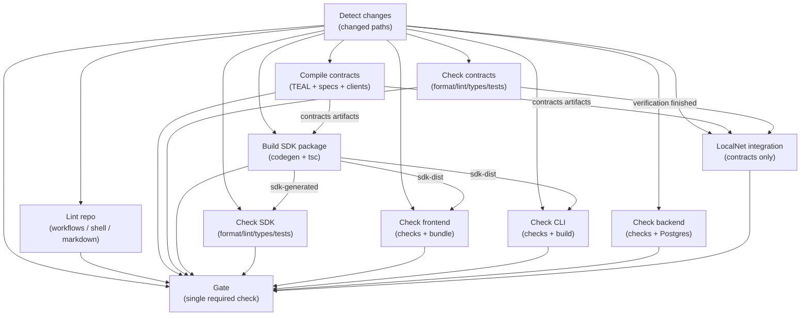

# CI

This page describes the GitHub Actions setup: a consolidated
[`build-and-test`](.github/workflows/build-and-test.yml) workflow with one
verification job per project plus repo-wide workflow, shell, and Markdown lint,
and the manual
[`release-specs`](.github/workflows/release-specs.yml),
[`release-sdk`](.github/workflows/release-sdk.yml), and
[`release-cli`](.github/workflows/release-cli.yml) releases - plus the
reasoning behind the splits.

## Principles

- **Build once, share the output.** The compiled contract artifacts (TEAL +
  ARC specs) are gitignored and regenerable. Only a contracts change triggers
  `compile-contracts`, which compiles them once and uploads `contracts-artifacts`;
  `build-sdk` and `integration-test` download it instead of recompiling. When
  the SDK or contracts changed, `build-sdk` runs codegen once, compiles the
  package once, and uploads both `sdk-generated` (the generated clients) and
  `sdk-dist` (the compiled package). The SDK verification job downloads
  `sdk-generated` instead of regenerating clients; the frontend and CLI
  download `sdk-dist` instead of each rebuilding the SDK. A `shared` or
  `config`-only run skips the producer, so SDK verification regenerates the
  clients from the pinned release itself. The SDK never copies generated
  clients between projects: it regenerates them from the ARC-56 specs, from the
  downloaded artifacts (`SDK_SPECS=local`) in contracts-changed runs and from
  the pinned release otherwise.
- **Split by prerequisite, not by phase.** Each project has one verification
  job that runs format, lint, type-check, and tests in order; a failed check
  does not stop the remaining checks, so one run reports them all. Contract
  compilation and SDK packaging are separate producer jobs only because other
  jobs consume their artifacts; `integration-test` adds Docker for LocalNet.
  Keeping those in separate jobs (not separate workflows) keeps feedback fast
  and failures attributable to the right lane.
- **Change detection, not matrices.** One `changes` job runs
  [`dorny/paths-filter`](https://github.com/dorny/paths-filter) and decides
  what every other job runs against. Each filter is a lane input: contracts,
  SDK, frontend, CLI, backend, `ci` (workflows/scripts), `config` (formatting),
  `oracle` (the contract test oracle; also the SDK vector source), and
  `markdown`. Unknown root paths land in `shared`, which fails open to the app
  lanes but never sets `contracts`: `compile-contracts` and `integration-test`
  run only when the contracts changed, and the contract suite runs only for the
  contracts or the oracle. Markdown, shell, and workflow files run only
  `repo-lint`; docs images, licenses, and inert root files run no lane.
  Separate jobs (no matrix) keep the conditional presence and the status-check
  names stable.
- **The frontend and CLI resolve the SDK by what changed.** A frontend-only,
  CLI-only, or shared-only change installs the published `@kasakame/sdk`, so
  routine work exercises what users install; an SDK or contracts change
  downloads the same-run `sdk-dist` built by `build-sdk` and installs that copy
  instead (see below). SDK verification consumes the same-run `sdk-generated`.
  The frontend and CLI build against the same SDK choice. The backend runs as
  its own job (it needs a Postgres service, so it doesn't fit the pure-Node
  jobs) and is independent of contracts, SDK, frontend, and CLI.
- **CI calls the per-project npm scripts directly** (`npm run lint`, …), not
  `algokit project run`. The algokit wrapper is a local convenience and runs
  projects sequentially.
- **Repo checks cover workflows, shell scripts, and Markdown.** The
  `repo-lint` job runs actionlint for `.github/**`, the runner's preinstalled
  ShellCheck over every tracked `.sh`/`.bash` file via `git ls-files`, and
  markdownlint. Each step is conditional on its filter and independent, so one
  failure does not hide the others. Workflow `run:` blocks are covered by
  actionlint's bundled ShellCheck.
- **Run once per change.** The workflow triggers on `pull_request` (any branch)
  and on `push` to `main` only - a same-repo branch would otherwise fire both
  `push` and `pull_request` events and run everything twice. Superseded PR runs
  are cancelled; `main` runs finish. Every `build-and-test` job has a
  `timeout-minutes` bound.

## Job graph



## What each job needs

| Job | Runs when | Node.js | AlgoKit CLI | Docker | Artifacts it consumes |
| --- | --- | --- | --- | --- | --- |
| `changes` | always | - | - | - | - |
| `repo-lint` | `ci`, `shell`, or `markdown` changed | ✅ | - | ✅ (actionlint image) | - |
| `compile-contracts` | contracts changed | ✅ | ✅ | - | - (produces `contracts-artifacts`) |
| `check-contracts` | contracts, `oracle`, or `config` changed | ✅ | - | - | - |
| `build-sdk` | SDK or contracts changed | ✅ | - | - | `contracts-artifacts` (contracts-changed runs); produces `sdk-generated` + `sdk-dist` |
| `check-sdk` | contracts, SDK, `shared`, or `config` changed | ✅ | - | - | `sdk-generated` when the producer ran; regenerates from the pinned release otherwise |
| `check-frontend` | contracts, SDK, frontend, `shared`, or `config` changed | ✅ | - | - | `sdk-dist` when SDK/contracts changed; published package otherwise |
| `check-cli` | contracts, SDK, CLI, `shared`, or `config` changed | ✅ | - | - | `sdk-dist` when SDK/contracts changed; published package otherwise |
| `check-backend` | backend, `shared`, or `config` changed | ✅ | - | ✅ (Postgres service) | - |
| `integration-test` | contracts changed | ✅ | ✅ | ✅ (algod + indexer) | `contracts-artifacts` |
| `gate` | always | ✅ (runner only) | - | - | - |
| `release-specs` (own workflow) | manual | ✅ | ✅ | - | - |
| `release-sdk` (own workflow) | manual | ✅ | - | - | - |
| `release-cli` (own workflow) | manual | ✅ | - | - | - |

Key point: **format/lint/type-check, unit-test, markdown, and shell lint need no
AlgoKit install**. `eslint`, `prettier`, `tsc`, `vitest`, `markdownlint-cli2`, and
`shellcheck` are standalone tools; `actionlint` is the one repo-lint step that
uses a container. The contracts verification job does not build anything: the
offline contract suite runs the contract source directly, and only
`compile-contracts` compiles. `build-sdk` runs codegen against the same-run
artifacts or the pinned release; SDK verification consumes the resulting clients,
and the frontend and CLI install the published SDK or the packed `sdk-dist` copy -
see below. The backend lane is the exception: its suite runs against a throwaway
Postgres service (static checks first, then migrations and tests).

Verification jobs run format → lint → type-check → tests → build (where a build
belongs to the job). A failed check does not stop the remaining checks: the job
still fails, but the log reports all of them together. Producer jobs
(`compile-contracts`, `build-sdk`) fail fast because there is no artifact to share
after a failure.

## Why the SDK build needs same-run contract artifacts

The SDK's write path imports the generated clients (`src/generated/*`,
gitignored), which `scripts/codegen.mjs` regenerates from ARC-56 specs with the
pinned `@algorandfoundation/algokit-client-generator`. By default codegen
downloads the pinned `specs-v<version>` release asset over HTTPS
(`.../releases/download/specs-v<version>/arc56.tar.gz`), so it needs no `gh`
login; `SDK_SPECS=local` reads
`projects/contracts/smart_contracts/artifacts` instead. On a
contracts-changed run `build-sdk` downloads `contracts-artifacts` and runs
codegen with `SDK_SPECS=local`, so the generated clients, the type-check, the
tests, and the built SDK all resolve against the change set's contracts;
otherwise it uses the pinned release. `build-sdk` uploads the generated clients
as `sdk-generated`, which SDK verification downloads instead of regenerating
them. Codegen never builds the contracts: local mode fails with instructions if
the artifacts are absent.

## How the frontend and CLI jobs resolve the SDK

The committed frontend and CLI dependency is `"@kasakame/sdk": "^0.1.0"` (see
[`sdk.md`](sdk.md)). On a frontend-only, CLI-only, or shared-only change those
lanes install it from the registry with `npm ci`, so routine work exercises
exactly what users install.

When the SDK or the contracts changed, `build-sdk` runs codegen and builds the
SDK package once (`npm ci` + `npm run build` in `projects/sdk`; codegen uses the
same-run artifacts when the contracts changed, the pinned release otherwise),
uploads `sdk-generated` and `sdk-dist`, and the frontend and CLI lanes download
`sdk-dist` and install it as a packed copy:

```sh
npm install --no-save --install-links "file:../sdk"
```

`--install-links` packs the SDK directory and installs it like a tarball (same
shape as the published package) instead of symlinking it; `--no-save` leaves
`package.json`/`package-lock.json` untouched. A plain `npm ci` afterwards
restores the published package. Local contract/SDK work uses the same command
(build the SDK first), so there is nothing to revert.

The `check-frontend` job bundles against the same SDK choice: published for
frontend-only, CLI-only, or shared-only changes, the same-run `sdk-dist` for
SDK/contracts changes. `check-cli` type-checks and builds against that same
choice. `check-sdk` downloads `sdk-generated` from the producer; when the
producer is skipped (`shared`/`config`-only changes), it regenerates from the
pinned release.

## Workflow: build-and-test

Implemented at `.github/workflows/build-and-test.yml`. Eleven jobs. `changes`
runs `dorny/paths-filter@v4.0.3`: PRs use the changed-files API (hence
`pull-requests: read`), and pushes to `main` diff against the previous commit
on the branch (`github.ref` as the base on pushes). Licenses are excluded from
every filter; Markdown files and `.markdownlint-cli2.jsonc` only set
`markdown`. It exposes twelve outputs:

- `contracts`, `sdk`, `frontend`, `cli`, `backend` - the project path itself, no
  folding. A contracts change does not set `sdk`, `frontend`, or `cli`; the lane
  conditions OR the inputs they need.
- `ci` - `.github/**` (workflows and release scripts).
- `config` - `.prettierrc.json`; triggers the verification lanes, not the
  contract/SDK producers.
- `oracle` - `docs/claim-tree-protocol-reference.py`, the contract/SDK test
  oracle.
- `markdown` - `**/*.md` and `.markdownlint-cli2.jsonc`.
- `shell` - tracked shell scripts: `**/*.sh` and `**/*.bash`.
- `shared` - any other non-inert path outside the five projects (root config, a
  new project). It fails open to the app lanes but never sets `contracts`:
  `compile-contracts` and `integration-test` run only when the contracts changed,
  and the contract suite runs only for the contracts or the oracle. Markdown,
  shell scripts, docs images, licenses, and inert root files are excluded from
  it.
- `local_sdk` - `contracts || sdk`: the frontend and CLI lanes download
  `sdk-dist` and install the local SDK; otherwise they use the published
  package. SDK verification consumes `sdk-generated` when the producer ran.

- **`changes`** - checkout with `fetch-depth: 0`, the paths-filter action, and
  the outputs; no Node setup, seconds of work.
- **`repo-lint`** - runs when `ci`, `shell`, or `markdown` is true. Runs
  actionlint in the `rhysd/actionlint:1.7.12` container (which bundles
  ShellCheck for workflow `run:` blocks), the runner's preinstalled ShellCheck
  over every tracked `.sh`/`.bash` file via `git ls-files`, and
  `npx --yes markdownlint-cli2@0.23.2` over every `*.md` file. The steps are
  independent, so one failure does not hide the others.
- **`compile-contracts`** - runs when `contracts` is true. Installs Node + AlgoKit,
  compiles the contracts (`npm run build` → TEAL + ARC-56 specs and generated
  clients), and uploads `contracts-artifacts` with `overwrite: true` and 7-day
  retention.
- **`check-contracts`** - runs when `contracts`, `oracle`, or `config` is true; pure
  Node. Runs format, lint, type-check, and `npm run test:coverage`. The offline
  suite runs the contract source directly, so it never needs the compiled
  artifacts. A failed check does not stop the rest.
- **`build-sdk`** - runs when `local_sdk` is true (SDK or contracts changed).
  Downloads `contracts-artifacts` when the contracts changed, installs the SDK
  dependencies, builds the package (`npm run build` → codegen + tsc), and
  uploads `sdk-generated` and `sdk-dist` (7-day retention).
- **`check-sdk`** - runs when `contracts`, `sdk`, `shared`, or `config` is true.
  Downloads `sdk-generated` when `build-sdk` ran; when the producer was skipped
  (`shared`/`config`-only changes), regenerates the clients from the pinned
  release. Then format, lint, type-check, and `npm run test:coverage`. It does
  not download `contracts-artifacts` directly.
- **`check-frontend`** - runs when `contracts`, `sdk`, frontend, `shared`, or
  `config` is true. Installs the published SDK with `npm ci`, or the same-run
  `sdk-dist` as a packed copy when `local_sdk` is true, then format, lint,
  type-check, `npm run test:coverage`, and `npx vite build`. The bundle gate is
  in this job, after the tests.
- **`check-cli`** - runs when `cli`, `sdk`, `contracts`, `shared`, or `config` is
  true. Installs the published SDK with `npm ci`, or the same-run `sdk-dist` as
  a packed copy for SDK/contracts changes, then format, lint, type-check,
  `npm run test:coverage`, and `npm run build`. The suite mocks the
  WalletConnect transport, so CI never contacts the bridge. See
  [`cli.md`](cli.md) and the [CLI tests](testing.md#cli-tests).
- **`check-backend`** - runs when `backend`, `shared`, or `config` is true: starts a
  Postgres service, runs format, lint, and type-check, then migrations and
  `npm run test:coverage`. It is independent of contracts/SDK/frontend/CLI.
- **`integration-test`** - runs when `contracts` is true and waits for
  `compile-contracts` (the artifact) and `check-contracts` (verification). It runs even
  if contract verification failed, so a lint/test failure still reports the
  LocalNet result: downloads `contracts-artifacts`, starts LocalNet, and runs
  the compiled TEAL against a live algod.
- **`gate`** - depends on all of the above and passes when every job is
  `success` or `skipped`; it fails on `failure`/`cancelled`. Branch protection
  requires only this check, so skipped jobs don't block a merge.

Verification jobs order the checks format → lint → type-check → tests → build,
and a failed check does not stop the later ones. The step conditions use
`!cancelled()` instead of the implicit `success()` gate, so a failed
format/lint/type-check still runs the tests and the bundle. The job still fails,
but one run reports all failures. `compile-contracts` and `build-sdk` fail fast
because there is no artifact to share after a failure.

`npm run format` runs Prettier in `--check` mode, so style drift fails the build
without modifying files.

## Workflow: release-specs (separate file)

Implemented at `.github/workflows/release-specs.yml`. Manual (`workflow_dispatch`)
release of the **contract interface**: it builds the contracts from the
dispatched commit, runs the offline contract tests, and attaches the compiled
per-app artifacts to a GitHub Release tagged `specs-v<version>` as one tarball
per artifact kind - `arc56.tar.gz` (ARC-56 specs), `arc32.tar.gz` (ARC-32
specs), `teal.tar.gz` (approval/clear TEAL), and `puya.tar.gz` (`*.puya.map`
source maps) - each keeping the per-app directories. Generated clients are
never attached. Its own file because it is a release, not a CI gate: it runs
manually (contracts rarely change) and needs `contents: write` to create the
release. The version is a dispatch input and must match
`projects/contracts/package.json`; bump that version in the release commit. The
specs series is independent of the published npm packages, started at `0.1.0`.
`prerelease` defaults on while the interface can still break on TestNet; GitHub
pre-release status only affects the "Latest" label, not downloads by tag.

The SDK pins `specs-v<version>` in `projects/sdk/package.json`
(`config.specsVersion`), downloads the public `arc56.tar.gz` asset over HTTPS by
default, and regenerates its clients from those specs with its own pinned
generator; `SDK_SPECS=local` uses
the contracts project's artifacts for contracts-changed lanes and local contract
work. Nothing generated is committed. The other tarballs serve deployers and
verifiers - the ARC-32 specs for legacy tooling and the TEAL + source maps for
independent recompile-and-verify audits.

## Workflow: release-sdk (separate file)

Implemented at `.github/workflows/release-sdk.yml`. Manual (`workflow_dispatch`)
release of `@kasakame/sdk`; no reviewer gate (single developer). The version is
`projects/sdk/package.json`; bump it in the release commit. The dispatch inputs
are:

- `version`: required, without the `v` prefix; must match the package version.
- `dry_run`: defaults to `true`; runs the gate, smoke test, package inspection,
  and the prep publish dry-run, but skips the real publish and registry check.

Prerelease versions publish under the `next` dist-tag, finals under `latest`.

- `prep` is Node/npm only and never builds the contracts: install, validate the
  input version against `package.json` and that it is unpublished, regenerate
  clients from the pinned `specs-vX.Y.Z` release, compile TypeScript, lint,
  format, type-check, run coverage, inspect the packed tarball, and dry-run the
  publish. Each command is its own step. It uploads the tested `dist/`.
- `smoke` runs `projects/sdk/scripts/smoke-package.mjs`: it packs the tested
  `dist/`, installs the tarball into a clean consumer, checks the version and
  `LICENSE`, imports the public API, and verifies `SPECS_VERSION` against the
  pin. It gates the publish.
- `publish` downloads the tested `dist/`, verifies the package files and
  version, and, when `dry_run=false`, publishes with the `next`/`latest`
  dist-tag through npm OIDC trusted publishing (`id-token: write`) with
  `--provenance`. It then polls the registry for the version, allowing 10
  minutes: npm stages a new package and the first publish took about 2.5
  minutes to become visible. A dry run stops before the publish and registry
  check.

Configure the trusted publisher for `@kasakame/sdk` on npmjs.com (package
Settings → Trusted Publisher) with GitHub owner `kasakame`, repository
`kasakame`, workflow `release-sdk.yml`, and no environment. Enable **Allow npm
publish**; leave **Allow npm dist-tag** off, because the workflow only passes
`--tag` to `npm publish` and never runs `npm dist-tag`. `npm stage publish` is
always allowed and needs no opt-in. The `npm trust github` CLI is the
equivalent (`--allow-publish`).

A new trusted publisher must complete its first publish within 2 days or it
expires and must be recreated. OIDC publishes do not prompt for 2FA: the job
exchanges the GitHub identity for a short-lived token. 2FA still gates
interactive actions (npmjs.com login, `npm trust`, and `npm stage approve`).
After the first OIDC publish succeeds, set the package's Publishing access to
"Require two-factor authentication and disallow tokens", delete the
`NPM_TOKEN` GitHub secret, and revoke the bootstrap token.

The frontend is built by its own release/deploy workflow against the published
version; it is not part of the SDK release.

Then dispatch the workflow from `main` with `dry_run=false`.

## Workflow: release-cli (separate file)

Implemented at `.github/workflows/release-cli.yml`. Manual (`workflow_dispatch`)
release of `@kasakame/cli`; no reviewer gate (single developer). The version is
`projects/cli/package.json`; bump it in the release commit. The dispatch inputs
mirror the SDK release:

- `version`: required, without the `v` prefix; must match the package version.
- `dry_run`: defaults to `true`; runs the gate, smoke test, package inspection,
  and the prep publish dry-run, but skips the real publish and registry check.

Prerelease versions publish under the `next` dist-tag, finals under `latest`.

- `prep` is Node/npm only and installs the **published** SDK with `npm ci` -
  never the `file:../sdk` copy, because a released CLI must ship against a
  released SDK. It validates the input version against `package.json` and that
  it is unpublished, then lints, formats, type-checks, runs coverage, builds,
  inspects the packed tarball, and dry-runs the publish. Each command is its own
  step. It uploads the tested `dist/`.
- `smoke` runs `projects/cli/scripts/smoke-package.mjs`: it packs the tested
  `dist/`, installs the tarball into a clean consumer, checks the version and
  `LICENSE`, and runs `kasakame --help`. It gates the publish.
- `publish` downloads the tested `dist/`, verifies the package files and
  version, and, when `dry_run=false`, publishes with the `next`/`latest`
  dist-tag through npm OIDC trusted publishing (`id-token: write`) with
  `--provenance`. It then polls the registry for the version for up to 10
  minutes, like the SDK release. A dry run stops before the publish and registry
  check.

Configure the trusted publisher for `@kasakame/cli` on npmjs.com (package
Settings → Trusted Publisher) with GitHub owner `kasakame`, repository
`kasakame`, workflow `release-cli.yml`, and no environment. The first-publish
window, 2FA enforcement, and token cleanup described for the SDK apply here too.
Release the SDK first: the CLI depends on the published `@kasakame/sdk`. The
package, its signers, and its commands are documented in [`cli.md`](cli.md).

## Release and distribution

These decisions cover how the protocol and its clients ship; the implementation
order is in [`roadmap.md`](roadmap.md) (Deployment section, plus the CLI section).

| Artifact | Canonical channel | Version | Notes |
| --- | --- | --- | --- |
| ARC-56/ARC-32 specs, TEAL, source maps | GitHub Release | `specs-vX.Y.Z` | One tarball per kind; the audit bundle. |
| `@kasakame/sdk` | npm | `X.Y.Z` (independent) | The only contract consumer; records the specs version it was built against. |
| `@kasakame/cli` | npm | `X.Y.Z` | Depends on the SDK; public indexer only, no backend. |
| Frontend | static host | deploy | Built against a published SDK for frontend-only changes. |
| Backend | deploy | - | Optional service; not an npm package. |

- **No specs npm package for now.** GitHub Releases stay canonical for ARC-56,
  ARC-32, TEAL, and source maps. Raw ARC-56 packages are uncommon, and the SDK
  ships generated clients, so a second channel adds maintenance without a
  consumer. The public release asset downloads over HTTPS without `gh` (a
  private repo would need an authenticated download). Revisit only if the SDK
  must build with only `npm ci` (no release download), external consumers need
  spec-only installs, the contracts repo becomes private after a split, or
  npm-native interface versioning is wanted.
- **If specs go to npm later**, publish a thin `@kasakame/specs` mirror from
  the same `release-specs` workflow at the same commit and version, primarily
  ARC-56; the GitHub release remains the canonical audit bundle. Never
  hand-maintain two copies.
- **Generated artifacts are never committed.** The contracts deployer and the
  SDK are the only client generators; the frontend and CLI consume the SDK.
  Everything is regenerated from the pinned specs with the pinned generator.

### Versions and release order

- `specs-vX.Y.Z` is the `projects/contracts/package.json` version; it is
  independent of the published npm package versions. The SDK pins the consumed
  specs version in `package.json` (`config.specsVersion`) and exports it as
  `SPECS_VERSION`.
- All three release workflows validate the dispatch version against their
  project `package.json` with `.github/scripts/check-release-version.mjs`.
- Release in order: contracts → specs release → SDK → frontend/CLI. A
  frontend-only change tests and deploys against the published SDK.
- Publish `0.1.0-rc.N` before `0.1.0`. The workflow maps prerelease versions to
  the `next` dist-tag and finals to `latest`; npm versions and `specs-v*` tags
  are never reused.

### npm publishing

- Publish only `@kasakame/sdk`, then `@kasakame/cli`. Both are public packages
  with a `files` whitelist.
- The SDK publishes only `dist/` plus the package metadata, README, and
  `LICENSE`; `publishConfig.access: "public"` makes the scoped package public.
- Published packages carry the root MIT `LICENSE` (copy it into each package
  directory) and declare `"license": "MIT"` in `package.json`.
- `release-sdk` and `release-cli` use npm OIDC trusted publishing; every publish
  passes `--provenance`. Set each package's publishing access to "Require
  two-factor authentication and disallow tokens" so only the trusted publisher
  can publish.
- **Planned hardening:** enable GitHub immutable releases for `specs-v*`,
  attach a `SHA256SUMS` asset, and verify it in the SDK codegen. Until then, the
  tag is the pin.
- The SDK must build without the contracts checkout: codegen downloads the
  pinned release by default. `SDK_SPECS=local` is the explicit override for
  contracts-changed lanes and local contract work.

### Repository shape

- Stay a monorepo for now; deployment layout is independent of repository
  layout. The SDK's spec-only build is what makes a split possible.
- Split only on a trigger: separate access/audit boundaries, divergent release
  cadence, CI cost, external teams, or conflicting deploy pipelines. A split
  moves contracts to its own repo, releases specs from there, and adds a
  separate SDK repo that pins those releases; the frontend then pins published
  SDK versions.

## Testing taxonomy

Contracts, frontend, and CLI test differently. Contract suites are offline AVM
tests with a 100% lines/branches/functions gate; frontend suites are Vitest
unit + component tests with a 100% gate on components and utils. The CLI's suite
is Vitest over the command layer with a mocked SDK and WalletConnect transport,
also gated at 100% on `src`, and its lane builds the package too. The SDK's
suite is pure Vitest over the chain layer (claim-tree math, replay, campaign
reads, and writes) with a 100% gate on `src`; `build-sdk` runs codegen first
(from the same-run artifacts with `SDK_SPECS=local`, or the pinned release) and
SDK verification consumes the generated clients so they resolve at import time.
Test layers are described in [`testing.md`](testing.md) (contracts and
[CLI](testing.md#cli-tests)) and [`frontend.md`](frontend.md) (frontend).

The offline contract tests don't need the AlgoKit CLI or Docker because the
`algorand-typescript-testing` transformer runs the contract source directly
under Node - the contracts verification job is pure Node and consumes nothing
from `compile-contracts`, never the compiled TEAL. `build-sdk` downloads
`contracts-artifacts` on contracts-changed runs (see above for why); SDK
verification consumes `sdk-generated`, and the frontend and CLI lanes install
the published SDK or the packed `sdk-dist` copy.

## Caching

No custom Docker image is built for any job. Tooling installs on the runner
and caches:

- **Node** - `actions/setup-node@v7` with `cache: npm` and
  `cache-dependency-path` pointing at the project's `package-lock.json`
  (`build-sdk` uses the SDK lockfile; the frontend and CLI jobs use their own
  lockfiles). This caches `node_modules`, so `npm ci` is ~seconds on cache hits.
- **AlgoKit (Python)** - installed fresh via `pipx` in the `compile-contracts`
  and `integration-test` jobs (not cached). The install is fast relative to the
  Docker container startup that dominates the integration job.

The Docker images in CI are **prebuilt**: `rhysd/actionlint:1.7.12` for
`repo-lint`, the Postgres service (backend job), and the algod/indexer
sandbox (integration job). If runner install time ever justifies a custom CI
image, publish it once to GHCR and rebuild only when its `Dockerfile` changes.

## Artifacts - sharing build output between jobs

`compile-contracts` and `build-sdk` upload the build outputs the other jobs
download, so nothing is compiled or built twice:

- **`contracts-artifacts`** - `projects/contracts/smart_contracts/artifacts`
  (TEAL, ARC-32/56 specs). Consumed by `build-sdk` (codegen input) and
  `integration-test`.
- **`sdk-generated`** - `projects/sdk/src/generated` (generated clients).
  Consumed by SDK verification, which otherwise regenerates them when
  `build-sdk` was skipped.
- **`sdk-dist`** - `projects/sdk/dist` (compiled package). Consumed by
  `check-frontend` and `check-cli`, which install it as `file:../sdk`.

The artifacts and `release-sdk`'s `sdk-dist` are kept for 7 days - long enough
to debug a failed run, short enough not to hoard storage.
