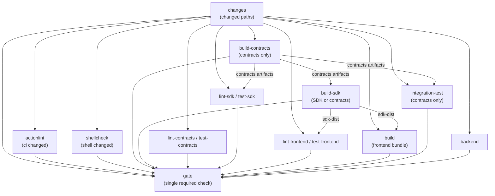

# CI

This page describes the GitHub Actions setup: a consolidated
[`build-and-test`](.github/workflows/build-and-test.yml) workflow,
a separate [`markdown-lint`](.github/workflows/markdown-lint.yml), and the
manual [`release-specs`](.github/workflows/release-specs.yml) release - plus
the reasoning behind the splits.

## Principles

- **Build once, share the output.** The compiled contract artifacts (TEAL +
  ARC specs) are gitignored and regenerable. Only a contracts change triggers
  `build-contracts`, which compiles them once and uploads `contracts-artifacts`;
  the SDK lanes and `integration-test` download it instead of recompiling. When
  the SDK or contracts changed, `build-sdk` builds the SDK package once and
  uploads `sdk-dist`; the frontend lanes and `build` download it instead of each
  rebuilding the SDK. The SDK never copies generated clients between projects:
  it regenerates them from the ARC-56 specs, from the downloaded artifacts
  (`SDK_SPECS=local`) in contracts-changed runs and from the pinned release
  otherwise.
- **Split by prerequisites.** Lint, format, type-check, and unit-test jobs need
  only Node.js; `build-contracts` adds Python for the AlgoKit CLI (contract
  compilation) and `integration-test` adds Docker for LocalNet too. Keeping
  those in separate jobs (not separate workflows) keeps feedback fast and
  failures attributable to the right lane.
- **Change detection, not matrices.** One `changes` job runs
  [`dorny/paths-filter`](https://github.com/dorny/paths-filter) and decides
  what every other job runs against. Each filter is a lane input: contracts,
  SDK, frontend, backend, `ci` (workflows/scripts), `config` (formatting), and
  `oracle` (the contract test oracle; also the SDK vector source). Unknown root
  paths land in `shared`,
  which fails open to the app lanes but never sets `contracts`:
  `build-contracts` and `integration-test` run only when the contracts changed,
  and the contract suite runs only for the contracts or the oracle. Markdown,
  docs images, licenses, and inert root files run no code lane (the separate
  markdown workflow owns Markdown). Separate jobs (no matrix) keep the
  conditional presence and the status-check names stable.
- **The frontend resolves the SDK by what changed.** A frontend-only or
  shared-only change installs the published `@kasakame/sdk`, so routine
  frontend work exercises what users install; an SDK or contracts change
  downloads the same-run `sdk-dist` built by `build-sdk` and installs that copy
  instead (see below). `build` bundles against the same choice. The backend
  runs as its own job (it needs a Postgres service, so it doesn't fit the
  pure-Node jobs) and is independent of contracts, SDK, and frontend.
- **CI calls the per-project npm scripts directly** (`npm run lint`, …), not
  `algokit project run`. The algokit wrapper is a local convenience and runs
  projects sequentially.
- **Shell scripts are linted repo-wide.** The `shellcheck` job runs the
  runner's preinstalled ShellCheck over every tracked `.sh`/`.bash` file.
  Workflow `run:` blocks are covered separately: actionlint runs its bundled
  ShellCheck on them.
- **Run once per change.** Both workflows trigger on `pull_request` (any branch)
  and on `push` to `main` only - a same-repo branch would otherwise fire both
  `push` and `pull_request` events and run everything twice. Superseded PR runs
  are cancelled; `main` runs finish. Every `build-and-test` job has a
  `timeout-minutes` bound.

## Job graph



## What each job needs

| Job | Runs when | Node.js | AlgoKit CLI | Docker | Artifacts it consumes |
| --- | --- | --- | --- | --- | --- |
| `changes` | always | - | - | - | - |
| `actionlint` | `ci` changed | - | - | ✅ (actionlint image) | - |
| `shellcheck` | `shell` changed | - | - | - | - |
| `build-contracts` | contracts changed | ✅ | ✅ | - | - (produces `contracts-artifacts`) |
| `build-sdk` | SDK or contracts changed | ✅ | - | - | `contracts-artifacts` (contracts-changed runs); produces `sdk-dist` |
| `lint-contracts` | contracts or `config` changed | ✅ | - | - | - |
| `test-contracts` | contracts or `oracle` changed | ✅ | - | - | - |
| `lint-sdk` | contracts, SDK, `shared`, or `config` changed | ✅ | - | - | `contracts-artifacts` (contracts-changed runs) |
| `test-sdk` | contracts, SDK, or `shared` changed | ✅ | - | - | `contracts-artifacts` (contracts-changed runs) |
| `lint-frontend` | contracts, SDK, frontend, `shared`, or `config` changed | ✅ | - | - | `sdk-dist` when SDK/contracts changed; published package otherwise |
| `test-frontend` | contracts, SDK, frontend, or `shared` changed | ✅ | - | - | `sdk-dist` when SDK/contracts changed; published package otherwise |
| `build` | contracts, SDK, frontend, or `shared` changed | ✅ | - | - | `sdk-dist` when SDK/contracts changed; published package otherwise |
| `backend` | backend, `shared`, or `config` changed | ✅ | - | ✅ (Postgres service) | - |
| `integration-test` | contracts changed | ✅ | ✅ | ✅ (algod + indexer) | contracts artifacts |
| `gate` | always | ✅ (runner only) | - | - | - |
| `markdown-lint` (own workflow) | markdown or its config changed | ✅ | - | - | - |
| `release-specs` (own workflow) | manual | ✅ | ✅ | - | - |

Key point: **lint/format/type-check, unit-test, markdown, and shell lint need no
AlgoKit install**. `eslint`, `prettier`, `tsc`, `vitest`, `markdownlint-cli2`, and
`shellcheck` are standalone tools; `actionlint` is the one workflow-lint job that
uses a container. The contracts lint/test jobs do not build anything: the offline
contract suite runs the contract source directly, and only `build-contracts`
compiles. The SDK
lanes run codegen against the same-run artifacts or the pinned release; the
frontend lanes install the published SDK or the packed `sdk-dist` copy - see
below. The backend lane is the exception: its suite runs against a throwaway
Postgres service (migrations first, like local development).

## Why the SDK lanes need same-run contract artifacts

The SDK's write path imports the generated clients (`src/generated/*`,
gitignored), which `scripts/codegen.mjs` regenerates from ARC-56 specs with the
pinned `@algorandfoundation/algokit-client-generator`. By default codegen
downloads the pinned `specs-v<version>` release asset over HTTPS
(`.../releases/download/specs-v<version>/arc56.tar.gz`), so it needs no `gh`
login; `SDK_SPECS=local` reads
`projects/contracts/smart_contracts/artifacts` instead. On a
contracts-changed run the SDK lanes and `build-sdk` download `contracts-artifacts`
and run codegen with `SDK_SPECS=local`, so type-check, tests, and the built SDK
resolve the clients against the change set's contracts; otherwise they use the
pinned release. Codegen never builds the contracts: local mode fails with
instructions if the artifacts are absent.

## How the frontend jobs resolve the SDK

The committed frontend dependency is `"@kasakame/sdk": "^0.1.0"` (see
[`sdk.md`](sdk.md)). On a frontend-only or shared-only change the frontend lanes
install it from the registry with `npm ci`, so routine frontend work exercises
exactly what users install; `build` bundles against that published copy too.

When the SDK or the contracts changed, `build-sdk` builds the SDK package once
(`npm ci` + `npm run build` in `projects/sdk`; codegen uses the same-run
artifacts when the contracts changed, the pinned release otherwise), uploads
`sdk-dist`, and the frontend lanes download it and install it as a packed copy:

```sh
npm install --no-save --install-links "file:../sdk"
```

`--install-links` packs the SDK directory and installs it like a tarball (same
shape as the published package) instead of symlinking it; `--no-save` leaves
`package.json`/`package-lock.json` untouched. A plain `npm ci` afterwards
restores the published package. Local contract/SDK work uses the same command
(build the SDK first), so there is nothing to revert.

The `build` job bundles against the same SDK choice: published for frontend-only
or shared-only changes, the same-run `sdk-dist` for SDK/contracts changes.

## Workflow: build-and-test

Implemented at `.github/workflows/build-and-test.yml`. Fifteen jobs. `changes`
runs `dorny/paths-filter@v4.0.3`: PRs use the changed-files API (hence
`pull-requests: read`), and pushes to `main` diff against the previous commit
on the branch (`github.ref` as the base on pushes). Markdown, licenses, and
`.markdownlint-cli2.jsonc` are excluded from every filter. It exposes ten
outputs:

- `contracts`, `sdk`, `frontend`, `backend` - the project path itself, no
  folding. A contracts change does not set `sdk` or `frontend`; the lane
  conditions OR the inputs they need.
- `ci` - `.github/**` (workflows and release scripts).
- `config` - `.prettierrc.json`; format/lint-only changes.
- `oracle` - `docs/claim-tree-protocol-reference.py`, the contract/SDK test
  oracle.
- `shell` - tracked shell scripts: `**/*.sh` and `**/*.bash`.
- `shared` - any other non-inert path outside the four projects (root config, a
  new project). It fails open to the app lanes but never sets `contracts`:
  `build-contracts` and `integration-test` run only when the contracts changed,
  and the contract suite runs only for the contracts or the oracle. Markdown,
  shell scripts, docs images, licenses, and inert root files are excluded.
- `local_sdk` - `contracts || sdk`: the frontend lanes download `sdk-dist` and
  install the local SDK; otherwise they use the published package.

- **`changes`** - checkout with `fetch-depth: 0`, the paths-filter action, and
  the outputs; no Node setup, seconds of work.
- **`actionlint`** - runs when `ci` is true. Lints the workflow files in the
  `rhysd/actionlint:1.7.12` container; the only lane a CI-only change needs.
  The image bundles ShellCheck, so it also checks every workflow `run:` block.
- **`shellcheck`** - runs when `shell` is true. Uses the runner's preinstalled
  ShellCheck (no install step) to lint every tracked `.sh`/`.bash` file via
  `git ls-files`. Standalone scripts only - workflow `run:` blocks belong to
  actionlint above.
- **`build-contracts`** - runs when `contracts` is true. Installs Node + AlgoKit,
  compiles the contracts (`npm run build` → TEAL + ARC-56 specs and generated
  clients), and uploads `contracts-artifacts` with `overwrite: true` and 7-day
  retention.
- **`build-sdk`** - runs when `local_sdk` is true (SDK or contracts changed).
  Downloads `contracts-artifacts` when the contracts changed, installs the SDK
  dependencies, builds the package (`npm run build` → codegen + tsc), and
  uploads `sdk-dist` (7-day retention). Frontend-only and shared-only changes
  skip it.
- **`lint-contracts`** - runs when `contracts` or `config` is true; pure Node
  (`npm ci`, then lint/format/type-check).
- **`test-contracts`** - runs when `contracts` or `oracle` is true; the offline
  suite runs the contract source directly, so it never needs the compiled
  artifacts.
- **`lint-sdk` / `test-sdk`** - run when `contracts`, `sdk`, or `shared` is true
  (`lint-sdk` also on `config`). When the contracts changed they download
  `contracts-artifacts` and codegen with `SDK_SPECS=local`; otherwise codegen
  downloads the pinned specs release. Then lint/format/type-check or
  `npm run test:coverage`.
- **`lint-frontend` / `test-frontend`** - run when `contracts`, `sdk`,
  frontend, or `shared` is true (`lint-frontend` also on `config`). When
  `local_sdk` is true they download `sdk-dist` and install the packed copy
  (`npm install --no-save --install-links "file:../sdk"`); otherwise they
  install the published package with `npm ci`. Then lint/format/type-check or
  `npm run test:coverage`.
- **`build`** - runs when `contracts`, `sdk`, frontend, or `shared` is true.
  Bundles the frontend with `npx vite build` against the published SDK or the
  same-run `sdk-dist`, matching the frontend lane choice. It is an independent
  production-bundle gate (catch Vite/Rollup-only failures), so it runs in
  parallel with lint and tests rather than after them.
- **`integration-test`** - runs when `contracts` is true: downloads
  `contracts-artifacts`, starts LocalNet, and runs the compiled TEAL against a
  live algod.
- **`backend`** - runs when `backend`, `shared`, or `config` is true: starts a
  Postgres service, runs migrations, then lint, format, type-check, and
  `npm run test:coverage` - the same sequence as local development. It is
  independent of contracts/SDK/frontend.
- **`gate`** - depends on all of the above and passes when every job is
  `success` or `skipped`; it fails on `failure`/`cancelled`. Branch protection
  requires only this check, so skipped jobs don't block a merge.

`npm run format` runs Prettier in `--check` mode, so style drift fails the build
without modifying files.

## Workflow: markdown-lint (separate file)

Implemented at `.github/workflows/markdown-lint.yml`. Markdown linting keeps its
**own workflow file**, because triggers live at the workflow level - a job
cannot have a different trigger than its workflow - and its `paths:` filter
(markdown files and `.markdownlint-cli2.jsonc`) is independent of the code
change detection. A markdown-only change therefore runs only this workflow and,
in `build-and-test`, `changes` + `gate` (every code lane skips); a mixed change
runs both.

The catch: a `paths`-filtered workflow cannot be a required status check,
because it never reports on PRs that touch no markdown, leaving the check
"Expected". It stays advisory unless it is folded into `Gate` as an always-run
job. The lint command checks all `*.md` files.

## Workflow: release-specs (separate file)

Implemented at `.github/workflows/release-specs.yml`. Manual (`workflow_dispatch`)
release of the **contract interface**: it builds the contracts from the
dispatched commit, runs the offline contract tests, and attaches the compiled
per-app artifacts to a GitHub Release tagged `specs-v<version>` as one tarball
per artifact kind - `arc56.tar.gz` (ARC-56 specs), `arc32.tar.gz` (ARC-32
specs), `teal.tar.gz` (approval/clear TEAL), and `puya.tar.gz` (`*.puya.map`
source maps) - each keeping the per-app directories. Generated clients are
never attached. Its own file because it is a release, not a CI gate: it runs
manually (contracts rarely change) and needs `contents: write` to create the
release. The version is a dispatch input and must match
`projects/contracts/package.json`; bump that version in the release commit. The
specs series is independent of the published npm packages, started at `0.1.0`.
`prerelease` defaults on while the interface can still break on TestNet; GitHub
pre-release status only affects the "Latest" label, not downloads by tag.

The SDK pins `specs-v<version>` in `projects/sdk/package.json`
(`config.specsVersion`), downloads the public `arc56.tar.gz` asset over HTTPS by
default, and regenerates its clients from those specs with its own pinned
generator; `SDK_SPECS=local` uses
the contracts project's artifacts for contracts-changed lanes and local contract
work. Nothing generated is committed. The other tarballs serve deployers and
verifiers - the ARC-32 specs for legacy tooling and the TEAL + source maps for
independent recompile-and-verify audits.

## Workflow: release-sdk (separate file)

Implemented at `.github/workflows/release-sdk.yml`. Manual (`workflow_dispatch`)
release of `@kasakame/sdk`; no reviewer gate (single developer). The version is
`projects/sdk/package.json`; bump it in the release commit. The dispatch inputs
are:

- `version`: required, without the `v` prefix; must match the package version.
- `dry_run`: defaults to `true`; runs the gate, smoke test, package inspection,
  and the prep publish dry-run, but skips the real publish and registry check.

Prerelease versions publish under the `next` dist-tag, finals under `latest`.

- `prep` is Node/npm only and never builds the contracts: install, validate the
  input version against `package.json` and that it is unpublished, regenerate
  clients from the pinned `specs-vX.Y.Z` release, compile TypeScript, lint,
  format, type-check, run coverage, inspect the packed tarball, and dry-run the
  publish. Each command is its own step. It uploads the tested `dist/`.
- `smoke` runs `projects/sdk/scripts/smoke-package.mjs`: it packs the tested
  `dist/`, installs the tarball into a clean consumer, checks the version and
  `LICENSE`, imports the public API, and verifies `SPECS_VERSION` against the
  pin. It gates the publish.
- `publish` downloads the tested `dist/`, verifies the package files and
  version, and, when `dry_run=false`, publishes with the `next`/`latest`
  dist-tag through npm OIDC trusted publishing (`id-token: write`) with
  `--provenance`. It then polls the registry for the version, allowing 10
  minutes: npm stages a new package and the first publish took about 2.5
  minutes to become visible. A dry run stops before the publish and registry
  check.

Configure the trusted publisher for `@kasakame/sdk` on npmjs.com (package
Settings → Trusted Publisher) with GitHub owner `kasakame`, repository
`kasakame`, workflow `release-sdk.yml`, and no environment. Enable **Allow npm
publish**; leave **Allow npm dist-tag** off, because the workflow only passes
`--tag` to `npm publish` and never runs `npm dist-tag`. `npm stage publish` is
always allowed and needs no opt-in. The `npm trust github` CLI is the
equivalent (`--allow-publish`).

A new trusted publisher must complete its first publish within 2 days or it
expires and must be recreated. OIDC publishes do not prompt for 2FA: the job
exchanges the GitHub identity for a short-lived token. 2FA still gates
interactive actions (npmjs.com login, `npm trust`, and `npm stage approve`).
After the first OIDC publish succeeds, set the package's Publishing access to
"Require two-factor authentication and disallow tokens", delete the
`NPM_TOKEN` GitHub secret, and revoke the bootstrap token.

The frontend is built by its own release/deploy workflow against the published
version; it is not part of the SDK release.

Then dispatch the workflow from `main` with `dry_run=false`.

## Release and distribution

These decisions cover how the protocol and its clients ship; the implementation
order is in [`roadmap.md`](roadmap.md) (Deployment section, plus the SDK CLI).

| Artifact | Canonical channel | Version | Notes |
| --- | --- | --- | --- |
| ARC-56/ARC-32 specs, TEAL, source maps | GitHub Release | `specs-vX.Y.Z` | One tarball per kind; the audit bundle. |
| `@kasakame/sdk` | npm | `X.Y.Z` (independent) | The only contract consumer; records the specs version it was built against. |
| `@kasakame/cli` | npm | `X.Y.Z` | Depends on the SDK; public indexer only, no backend. |
| Frontend | static host | deploy | Built against a published SDK for frontend-only changes. |
| Backend | deploy | - | Optional service; not an npm package. |

- **No specs npm package for now.** GitHub Releases stay canonical for ARC-56,
  ARC-32, TEAL, and source maps. Raw ARC-56 packages are uncommon, and the SDK
  ships generated clients, so a second channel adds maintenance without a
  consumer. The public release asset downloads over HTTPS without `gh` (a
  private repo would need an authenticated download). Revisit only if the SDK
  must build with only `npm ci` (no release download), external consumers need
  spec-only installs, the contracts repo becomes private after a split, or
  npm-native interface versioning is wanted.
- **If specs go to npm later**, publish a thin `@kasakame/specs` mirror from
  the same `release-specs` workflow at the same commit and version, primarily
  ARC-56; the GitHub release remains the canonical audit bundle. Never
  hand-maintain two copies.
- **Generated artifacts are never committed.** The contracts deployer and the
  SDK are the only client generators; the frontend and CLI consume the SDK.
  Everything is regenerated from the pinned specs with the pinned generator.

### Versions and release order

- `specs-vX.Y.Z` is the `projects/contracts/package.json` version; it is
  independent of the published npm package versions. The SDK pins the consumed
  specs version in `package.json` (`config.specsVersion`) and exports it as
  `SPECS_VERSION`.
- Both release workflows validate the dispatch version against their project
  `package.json` with `.github/scripts/check-release-version.mjs`.
- Release in order: contracts → specs release → SDK → frontend/CLI. A
  frontend-only change tests and deploys against the published SDK.
- Publish `0.1.0-rc.N` before `0.1.0`. The workflow maps prerelease versions to
  the `next` dist-tag and finals to `latest`; npm versions and `specs-v*` tags
  are never reused.

### npm publishing

- Publish only `@kasakame/sdk`, then `@kasakame/cli`. Both are public packages
  with a `files` whitelist.
- The SDK publishes only `dist/` plus the package metadata, README, and
  `LICENSE`; `publishConfig.access: "public"` makes the scoped package public.
- Published packages carry the root MIT `LICENSE` (copy it into each package
  directory) and declare `"license": "MIT"` in `package.json`.
- The `release-sdk` workflow uses npm OIDC trusted publishing; every publish
  passes `--provenance`. Set the package's publishing access to "Require
  two-factor authentication and disallow tokens" so only the trusted publisher
  can publish.
- **Planned hardening:** enable GitHub immutable releases for `specs-v*`,
  attach a `SHA256SUMS` asset, and verify it in the SDK codegen. Until then, the
  tag is the pin.
- The SDK must build without the contracts checkout: codegen downloads the
  pinned release by default. `SDK_SPECS=local` is the explicit override for
  contracts-changed lanes and local contract work.

### Repository shape

- Stay a monorepo for now; deployment layout is independent of repository
  layout. The SDK's spec-only build is what makes a split possible.
- Split only on a trigger: separate access/audit boundaries, divergent release
  cadence, CI cost, external teams, or conflicting deploy pipelines. A split
  moves contracts to its own repo, releases specs from there, and adds a
  separate SDK repo that pins those releases; the frontend then pins published
  SDK versions.

## Testing taxonomy

Contracts and frontend test differently. Contract suites are offline AVM tests
with a 100% lines/branches/functions gate; frontend suites are Vitest unit +
component tests with a 100% gate on components and utils. The SDK's suite is
pure Vitest over the chain layer (claim-tree math, replay, campaign reads, and
writes) with a 100% gate on `src`; its lane runs the codegen first (from the
same-run artifacts with `SDK_SPECS=local`, or the pinned release) so the
generated clients resolve at import time. All are
described in [`testing.md`](testing.md) (contracts) and
[`frontend.md`](frontend.md) (frontend).

The offline contract tests don't need the AlgoKit CLI or Docker because the
`algorand-typescript-testing` transformer runs the contract source directly
under Node - the contracts jobs are pure Node and consume nothing from
`build-contracts`, never the compiled TEAL. The SDK lanes and `build-sdk`
download `contracts-artifacts` on contracts-changed runs (see above for why);
the frontend lanes install the published SDK or the packed `sdk-dist` copy.

## Caching

No custom Docker image is built for any job. Tooling installs on the runner
and caches:

- **Node** - `actions/setup-node@v7` with `cache: npm` and
  `cache-dependency-path` pointing at the project's `package-lock.json`
  (`build-sdk` uses the SDK lockfile; the frontend jobs use the frontend
  lockfile). This caches `node_modules`, so `npm ci` is ~seconds on cache hits.
- **AlgoKit (Python)** - installed fresh via `pipx` in the `build-contracts`
  and `integration-test` jobs (not cached). The install is fast relative to the
  Docker container startup that dominates the integration job.

The Docker images in CI are **prebuilt**: `rhysd/actionlint:1.7.12` for the
workflow lint, the Postgres service (backend job), and the algod/indexer sandbox
(integration job). If runner install time ever justifies a custom CI image,
publish it once to GHCR and rebuild only when its `Dockerfile` changes.

## Artifacts - sharing build output between jobs

`build-contracts` and `build-sdk` upload the build outputs the other jobs
download, so nothing is compiled or built twice:

- **`contracts-artifacts`** - `projects/contracts/smart_contracts/artifacts`
  (TEAL, ARC-32/56 specs). Consumed by `build-sdk` (codegen input),
  `integration-test`, and the SDK lanes (they regenerate clients from it with
  `SDK_SPECS=local`).
- **`sdk-dist`** - `projects/sdk/dist` (compiled package). Consumed by
  `lint-frontend`, `test-frontend`, and `build`, which install it as
  `file:../sdk`.

Both artifacts and `release-sdk`'s `sdk-dist` are kept for 7 days - long enough
to debug a failed run, short enough not to hoard storage.
