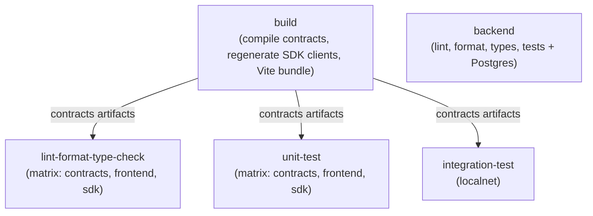

# CI

This page describes the GitHub Actions setup: a consolidated
[`build-and-test`](.github/workflows/build-and-test.yml) workflow,
a separate [`markdown-lint`](.github/workflows/markdown-lint.yml), and the
manual [`release-specs`](.github/workflows/release-specs.yml) release - plus
the reasoning behind the splits.

## Principles

- **Build once, share the output.** The compiled contract artifacts (TEAL +
  ARC specs) are gitignored and regenerable. One `build` job produces them and
  uploads them as artifacts; downstream jobs download what they need instead of
  recompiling. The SDK never copies generated clients between projects: it
  regenerates them from the ARC-56 specs, using the downloaded artifacts
  (`SDK_SPECS=local`) in these lanes and the pinned release elsewhere.
- **Split by prerequisites.** Lint, format, type-check, and unit-test jobs need
  only Node.js; the `build` job adds Python for the AlgoKit CLI (contract
  compilation), and `integration-test` adds Docker for LocalNet too. Keeping
  those in separate jobs (not separate workflows) keeps feedback fast and
  failures attributable to the right lane.
- **Parallel lanes per project.** `contracts`, `frontend`, and `sdk` are
  independent npm projects; the per-project jobs run them side by side via a
  matrix. The backend runs as its own job (it needs a Postgres service, so it
  doesn't fit the pure-Node matrix).
- **CI calls the per-project npm scripts directly** (`npm run lint`, …), not
  `algokit project run`. The algokit wrapper is a local convenience and runs
  projects sequentially.
- **Run once per change.** Both workflows trigger on `pull_request` (any branch)
  and on `push` to `main` only - a same-repo branch would otherwise fire both
  `push` and `pull_request` events and run everything twice.

## Job graph

## What each job needs

| Job | Node.js | AlgoKit CLI | Docker | Artifacts it consumes |
| --- | --- | --- | --- | --- |
| `build` | ✅ | ✅ | - | - |
| `lint-format-type-check` | ✅ | - | - | contracts artifacts |
| `unit-test` | ✅ | - | - | contracts artifacts |
| `backend` | ✅ | - | ✅ (Postgres service) | - |
| `integration-test` | ✅ | ✅ | ✅ (algod + indexer) | contracts artifacts |
| `markdown-lint` (own workflow) | ✅ | - | - | - |
| `release-specs` (own workflow) | ✅ | ✅ | - | - |

Key point: **lint/format/type-check, unit-test, and markdown are pure Node**.
`eslint`, `prettier`, `tsc`, `vitest`, and `markdownlint-cli2` need no Docker
or AlgoKit install; they only download the `build` job's artifacts and run the
SDK's codegen (the sdk lane) or build the SDK (the frontend lanes), with
`SDK_SPECS=local` so codegen reads the downloaded ARC-56 specs - see below. The
backend lane is the exception: its suite runs against a throwaway Postgres
service (migrations first, like local development).

## Why the SDK and frontend need the build's output

The SDK's write path imports the generated clients (`src/generated/*`,
gitignored), which `scripts/codegen.mjs` regenerates from ARC-56 specs with the
pinned `@algorandfoundation/algokit-client-generator`. By default codegen
downloads the pinned `specs-v<version>` release asset over HTTPS
(`.../releases/download/specs-v<version>/arc56.tar.gz`), so it needs no `gh`
login; `SDK_SPECS=local` reads
`projects/contracts/smart_contracts/artifacts` instead. The `sdk` lane downloads
`contracts-artifacts` and runs `npm run codegen` with `SDK_SPECS=local`, so
type-check and tests resolve the clients without a release download and against
the change set's contracts. Codegen never builds the contracts: local mode fails
with instructions if the artifacts are absent.

Current CI sets `SDK_SPECS=local` at the workflow level in `build-and-test`,
because every SDK build there tests the same commit's contracts and the
frontend's `pre*` hooks rebuild the SDK in later steps. The roadmap's CI change
detection will switch SDK-only lanes to the pinned release and frontend-only
lanes to the published SDK; until then, local is the same-SHA end-to-end gate.

## Why the frontend lanes build the SDK

The frontend consumes `@kasakame/sdk` as `"@kasakame/sdk": "file:../sdk"` with
a prebuilt `dist/` (see [`sdk.md`](sdk.md)), so **both the frontend type-check
and its unit tests resolve that `dist/`**. The `lint-format-type-check` and
`unit-test` frontend lanes therefore install the SDK's dependencies and build it
before running their scripts (`tsc` emit, seconds; the SDK's prebuild codegen
regenerates the clients from the `contracts-artifacts` those lanes also download,
with `SDK_SPECS=local`). Cheaper to rebuild per lane than to shuttle another
artifact. The frontend's own `pre*` npm hooks rebuild it on demand for local dev.

## Workflow: build-and-test

Implemented at `.github/workflows/build-and-test.yml`. Five jobs, with
`build` as the upstream dependency:

- **`build`** - installs Node + AlgoKit, compiles the contracts (`npm run
  build` → TEAL + ARC-56 specs), builds the SDK (`npm run build`; its prebuild
  codegen regenerates the clients from those specs, `SDK_SPECS=local`), bundles
  the frontend (`npx vite build`), and uploads one artifact:
  `contracts-artifacts`.
- **`lint-format-type-check`** - matrix over `[contracts, frontend, sdk]`. The
  sdk and frontend lanes download `contracts-artifacts`; the sdk lane runs
  `npm run codegen` and the frontend lane's SDK build does it via its prebuild
  hook, both with `SDK_SPECS=local`. Then each lane runs lint, format, and
  type-check. `fail-fast` is off so one project's failure doesn't cancel the
  other lanes.
- **`unit-test`** - matrix over `[contracts, frontend, sdk]`. The same
  artifact/codegen downloads as the lint lane, then each lane runs
  `npm run test:coverage`.
- **`backend`** - standalone (needs nothing from `build`): starts a Postgres
  service, runs migrations, then lint, format, type-check, and
  `npm run test:coverage` - the same sequence as local development.
- **`integration-test`** - downloads `contracts-artifacts`, starts LocalNet,
  and runs the compiled TEAL against a live algod.

`npm run format` runs Prettier in `--check` mode, so style drift fails the build
without modifying files.

## Workflow: markdown-lint (separate file)

Implemented at `.github/workflows/markdown-lint.yml`. Markdown linting gets its
**own workflow file**, because triggers live at the workflow level - a job
cannot have a different trigger than its workflow. Splitting it allows a
`paths:` filter so the markdown job only runs when docs (or the markdownlint
config) change.

This also gives markdown its own status check, so a docs failure isn't buried
under the per-project matrix. The lint command checks all
`*.md` files; the `paths:` filter limits runs to docs changes.

## Workflow: release-specs (separate file)

Implemented at `.github/workflows/release-specs.yml`. Manual (`workflow_dispatch`)
release of the **contract interface**: it builds the contracts from the
dispatched commit, runs the offline contract tests, and attaches the compiled
per-app artifacts to a GitHub Release tagged `specs-v<version>` as one tarball
per artifact kind - `arc56.tar.gz` (ARC-56 specs), `arc32.tar.gz` (ARC-32
specs), `teal.tar.gz` (approval/clear TEAL), and `puya.tar.gz` (`*.puya.map`
source maps) - each keeping the per-app directories. Generated clients are
never attached. Its own file because it is a release, not a CI gate: it runs
manually (contracts rarely change) and needs `contents: write` to create the
release. The version is a dispatch input and must match
`projects/contracts/package.json`; bump that version in the release commit. The
specs series is independent of the published npm packages, started at `0.1.0`.
`prerelease` defaults on while the interface can still break on TestNet; GitHub
pre-release status only affects the "Latest" label, not downloads by tag.

The SDK pins `specs-v<version>` in `projects/sdk/package.json`
(`config.specsVersion`), downloads the public `arc56.tar.gz` asset over HTTPS by
default, and regenerates its clients from those specs with its own pinned
generator; `SDK_SPECS=local` uses
the contracts project's artifacts for contracts-changed lanes and local contract
work. Nothing generated is committed. The other tarballs serve deployers and
verifiers - the ARC-32 specs for legacy tooling and the TEAL + source maps for
independent recompile-and-verify audits.

## Workflow: release-sdk (separate file)

Implemented at `.github/workflows/release-sdk.yml`. Manual (`workflow_dispatch`)
release of `@kasakame/sdk`; no reviewer gate (single developer). The version is
`projects/sdk/package.json`; bump it in the release commit. The dispatch inputs
are:

- `version`: required, without the `v` prefix; must match the package version.
- `dry_run`: defaults to `true`; runs the gate, smoke test, package inspection,
  and the prep publish dry-run, but skips the real publish and registry check.
- `bootstrap`: first release only; publishes with the `NPM_TOKEN` secret instead
  of OIDC.

Prerelease versions publish under the `next` dist-tag, finals under `latest`.

- `prep` is Node/npm only and never builds the contracts: install, validate the
  input version against `package.json` and that it is unpublished, regenerate
  clients from the pinned `specs-vX.Y.Z` release, compile TypeScript, lint,
  format, type-check, run coverage, inspect the packed tarball, and dry-run the
  publish. Each command is its own step. It uploads the tested `dist/`.
- `smoke` runs `projects/sdk/scripts/smoke-package.mjs`: it packs the tested
  `dist/`, installs the tarball into a clean consumer, checks the version and
  `LICENSE`, imports the public API, and verifies `SPECS_VERSION` against the
  pin. It gates the publish.
- `publish` downloads the tested `dist/`, verifies the package files and
  version, and, when `dry_run=false`, publishes with the `next`/`latest`
  dist-tag. Normal runs authenticate through npm OIDC trusted publishing
  (`id-token: write`); a dispatch with `bootstrap=true` uses the `NPM_TOKEN`
  secret. Both paths pass `--provenance`, so the bootstrap release gets a
  provenance attestation too. It then checks the version is visible in the
  registry. A dry run stops before the publish and registry check.

The first release is a bootstrap: npm requires the package to exist before a
trusted publisher can be configured, so dispatch with `dry_run=false`,
`bootstrap=true`, and a short-lived granular token in the `NPM_TOKEN` secret
(for example, a `0.1.0-rc.1` publish). The token needs read/write access to the
`@kasakame` package scope and 2FA bypass; do not reuse a read-only install
token. After that release creates the package, configure the trusted publisher,
delete the secret, and revoke the token. Future runs set `dry_run=false`, leave
`bootstrap=false`, and authenticate with OIDC. Provenance is not tied to
trusted-publishing authentication: a token publish with `--provenance` from a
public repository and public package produces an attestation too
([npm provenance docs](https://docs.npmjs.com/generating-provenance-statements)).

The frontend is built by its own release/deploy workflow against the published
version; it is not part of the SDK release.

Configure the npm trusted publisher for `@kasakame/sdk` with GitHub owner
`kasakame`, repository `kasakame`, workflow `release-sdk.yml`, and no
environment. Then dispatch the workflow from `main` with `dry_run=false` and
`bootstrap=false`.

## Release and distribution

These decisions cover how the protocol and its clients ship; the implementation
order is in [`roadmap.md`](roadmap.md) (SDK and CI & packaging sections).

| Artifact | Canonical channel | Version | Notes |
| --- | --- | --- | --- |
| ARC-56/ARC-32 specs, TEAL, source maps | GitHub Release | `specs-vX.Y.Z` | One tarball per kind; the audit bundle. |
| `@kasakame/sdk` | npm | `X.Y.Z` (independent) | The only contract consumer; records the specs version it was built against. |
| `@kasakame/cli` | npm | `X.Y.Z` | Depends on the SDK; public indexer only, no backend. |
| Frontend | static host | deploy | Built against a published SDK for frontend-only changes. |
| Backend | deploy | - | Optional service; not an npm package. |

- **No specs npm package for now.** GitHub Releases stay canonical for ARC-56,
  ARC-32, TEAL, and source maps. Raw ARC-56 packages are uncommon, and the SDK
  ships generated clients, so a second channel adds maintenance without a
  consumer. The public release asset downloads over HTTPS without `gh` (a
  private repo would need an authenticated download). Revisit only if the SDK
  must build with only `npm ci` (no release download), external consumers need
  spec-only installs, the contracts repo becomes private after a split, or
  npm-native interface versioning is wanted.
- **If specs go to npm later**, publish a thin `@kasakame/specs` mirror from
  the same `release-specs` workflow at the same commit and version, primarily
  ARC-56; the GitHub release remains the canonical audit bundle. Never
  hand-maintain two copies.
- **Generated artifacts are never committed.** The contracts deployer and the
  SDK are the only client generators; the frontend and CLI consume the SDK.
  Everything is regenerated from the pinned specs with the pinned generator.

### Versions and release order

- `specs-vX.Y.Z` is the `projects/contracts/package.json` version; it is
  independent of the published npm package versions. The SDK pins the consumed
  specs version in `package.json` (`config.specsVersion`) and exports it as
  `SPECS_VERSION`.
- Both release workflows validate the dispatch version against their project
  `package.json` with `.github/scripts/check-release-version.mjs`.
- Release in order: contracts → specs release → SDK → frontend/CLI. A
  frontend-only change tests and deploys against the published SDK.
- Publish `0.1.0-rc.N` before `0.1.0`. The workflow maps prerelease versions to
  the `next` dist-tag and finals to `latest`; npm versions and `specs-v*` tags
  are never reused.

### npm publishing

- Publish only `@kasakame/sdk`, then `@kasakame/cli`. Both are public packages
  with a `files` whitelist.
- The SDK publishes only `dist/` plus the package metadata, README, and
  `LICENSE`; `publishConfig.access: "public"` makes the scoped package public.
- Published packages carry the root MIT `LICENSE` (copy it into each package
  directory) and declare `"license": "MIT"` in `package.json`.
- The `release-sdk` workflow uses npm OIDC trusted publishing after the first
  bootstrap; every publish passes `--provenance`. The first bootstrap uses a
  short-lived `NPM_TOKEN` secret because the package must exist before the
  trusted publisher can be configured. No long-lived token: delete the secret
  and revoke the token after the bootstrap.
- **Planned hardening:** enable GitHub immutable releases for `specs-v*`,
  attach a `SHA256SUMS` asset, and verify it in the SDK codegen. Until then, the
  tag is the pin.
- The SDK must build without the contracts checkout: codegen downloads the
  pinned release by default. `SDK_SPECS=local` is the explicit override for
  contracts-changed lanes and local contract work.

### Repository shape

- Stay a monorepo for now; deployment layout is independent of repository
  layout. The SDK's spec-only build is what makes a split possible.
- Split only on a trigger: separate access/audit boundaries, divergent release
  cadence, CI cost, external teams, or conflicting deploy pipelines. A split
  moves contracts to its own repo, releases specs from there, and adds a
  separate SDK repo that pins those releases; the frontend then pins published
  SDK versions.

## Testing taxonomy

Contracts and frontend test differently. Contract suites are offline AVM tests
with a 100% lines/branches/functions gate; frontend suites are Vitest unit +
component tests with a 100% gate on components and utils. The SDK's suite is
pure Vitest over the chain layer (claim-tree math, replay, campaign reads, and
writes) with a 100% gate on `src`; its lane runs the codegen first
(`SDK_SPECS=local`) so the generated clients resolve at import time. All are
described in [`testing.md`](testing.md) (contracts) and
[`frontend.md`](frontend.md) (frontend).

The offline contract tests don't need the AlgoKit CLI or Docker because the
`algorand-typescript-testing` transformer runs the contract source directly
under Node - the contract lane is pure Node and consumes nothing from the build
job, never the compiled TEAL. The sdk and frontend lanes of the same job do
download the build job's `contracts-artifacts` (see above for why).

## Caching

No custom Docker image is built or pulled for any job. Tooling installs on
the runner and caches:

- **Node** - `actions/setup-node@v7` with `cache: npm` and
  `cache-dependency-path` pointing at the project's `package-lock.json`. This
  caches `node_modules`, so `npm ci` is ~seconds on cache hits. (Three setup-node
  steps in `build`, one per project's lockfile.)
- **AlgoKit (Python)** - installed fresh via `pipx` in the `build` and
  `integration-test` jobs (not cached). The install is fast relative to the
  Docker container startup that dominates the integration job.

The only Docker in CI is **prebuilt** images: the Postgres service (backend
job) and the algod/indexer sandbox (integration job, pulled only there). If runner install time ever justifies a custom
CI image, publish it once to GHCR and rebuild only when its `Dockerfile` changes.

## Artifacts - sharing build output between jobs

The `build` job uploads one artifact that downstream jobs download, so nothing
is compiled twice:

- **`contracts-artifacts`** - `projects/contracts/smart_contracts/artifacts`
  (TEAL, ARC-32/56 specs). Consumed by `integration-test`, and by
  `lint-format-type-check` and `unit-test` (the sdk lane regenerates clients
  from it; the frontend lane's SDK build does the same) - all with
  `SDK_SPECS=local`.
